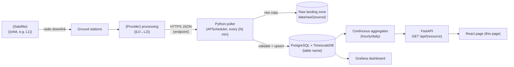

# About this page: <Page name>

> Template for every page/section of Tachocline Industries (see [ADR 0009](decisions/0009-about-this-page-for-every-section.md)).
> Copy to `docs/about/<page-slug>.md`. Keep it to about one screen per section. Replace everything in `<angle brackets>`.
> **Last reviewed:** <YYYY-MM-DD> · **Owner:** Howard Isaacson

---

## 1. Purpose
<1–3 sentences: what question does this page answer, and for whom?>
*Example: "Shows the solar wind arriving at the L1 point right now, the early warning for geomagnetic storms at Earth, 15–60 minutes ahead."*

## 2. What you're seeing
<Explain each chart/panel in plain language: axes, units, colours, what "normal" vs "interesting" looks like.>
- **<Panel name>:** <what it shows> · units: <e.g., km/s> · normal range: <…> · interesting when: <…>

## 3. Data source & cadence
| Item | Value |
|---|---|
| Provider | <e.g., NOAA SWPC> |
| Satellite(s) / instrument(s) | <e.g., SOLAR-1 SWiPS & MAG; ACE (backup)> |
| Endpoint | `<URL>` |
| Format / access | <JSON over HTTPS, no auth> |
| Upstream update cadence | <e.g., 1-minute records, rolling ~24 h> |
| Our polling cadence | <e.g., every 5 min> |
| End-to-end latency | <measurement → our chart, approx.> |
| Processing level | <e.g., L2 real-time, provisional> |
| History we keep | <e.g., since YYYY-MM-DD; raw files retained N days> |

## 4. Data flow

<1–2 sentences walking through the diagram, in order. Replace `{placeholders}` in the diagram (curly braces, because Mermaid treats angle brackets as HTML); remove boxes that don't apply.>

## 5. Tech used and why
| Layer | Technology | Why (one line) | Decision |
|---|---|---|---|
| Ingestion | Python, httpx, pydantic, APScheduler | <…> | [ADR 0004](decisions/0004-python-scheduled-pollers-with-raw-landing-zone.md) |
| Storage | PostgreSQL + TimescaleDB | <…> | [ADR 0005](decisions/0005-postgresql-timescaledb-for-time-series-storage.md) |
| API | FastAPI | <…> | [ADR 0006](decisions/0006-fastapi-for-backend-api.md) |
| Visualisation | Grafana / React + Plotly.js | <…> | [ADR 0007](decisions/0007-grafana-now-react-later-for-frontend.md) |
| Runtime | Docker Compose, modular monolith | <…> | [ADR 0002](decisions/0002-build-locally-first-with-docker-compose.md), [ADR 0008](decisions/0008-modular-monolith-before-microservices.md) |
| <Source-specific> | <…> | <…> | [ADR 00NN](decisions/) |

Key code: `<path/to/poller.py>`, `<db/migrations/NNNN_….sql>`, `<api/routes/….py>`, `<dashboards/….json>`

## 6. Known limitations
- <Data gaps, e.g., "No data when the local machine is off (built locally, ADR 0002).">
- <Data quality, e.g., "Real-time data is provisional; SWPC does not yet publish quality flags.">
- <Upstream risk, e.g., "Endpoints changed in 2026 (see ADR 0003); a schema change would show up as rejects in ingest_log.">
- <What I'd do next to fix each one.>

## 7. Interview talking points
- **30-second pitch:** <the problem, the data, the pipeline, the result>
- **Hardest problem:** <e.g., deduplicating multi-spacecraft rows with an upsert on (time_tag, source)>
- **Trade-off I made:** <e.g., 5-minute polling vs freshness vs politeness to the server>
- **How I know it works:** <tests, ingest_log, freshness panel>
- **If I had more time / at scale:** <e.g., orchestrator, streaming, cloud deployment>
- **Likely questions & my answers:**
  - Q: <"What happens if the API is down for an hour?"> A: <…>
  - Q: <"Why not InfluxDB?"> A: <…>

## 8. Glossary
| Term | Plain-language meaning |
|---|---|
| <e.g., L1 (Lagrange point 1)> | <Spot ~1.5 million km toward the Sun where a spacecraft stays put between Sun and Earth.> |
| <e.g., Bz> | <North–south component of the solar magnetic field; strongly southward Bz lets energy into Earth's magnetosphere.> |
| <e.g., Upsert> | <Insert a row, or update it if it already exists, so reruns don't create duplicates.> |
| <e.g., Hypertable> | <A TimescaleDB table automatically split into time chunks for fast queries.> |
