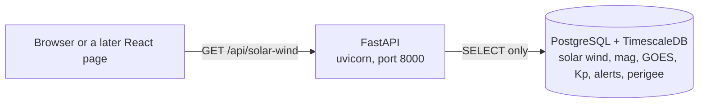

# About this page: Read-only API

> **Last reviewed:** 2026-10-27 · **Owner:** Howard Isaacson
>
> Written from [the About template](../about-this-page-template.md) ([ADR 0009](../decisions/0009-about-this-page-for-every-section.md)).

The interactive docs are at `http://127.0.0.1:8000/docs` (host port `API_PORT`). That page is generated from the code. The public site at `http://127.0.0.1:8080` calls the Kp routes through the `web` container, which proxies `/api` to this service. This write-up is [`docs/about/api.md`](https://github.com/howardisaacson/tachocline-industries/blob/main/docs/about/api.md).

## 1. Purpose
Gives the future website, and any agent, a way to read stored rows without a database login. The service is for someone calling `GET /api/solar-wind` or `GET /api/satellite-perigee`, and for an interviewer asking why the browser does not connect to Postgres. Every route is read-only. The numbers are real-time products, not a forecast. Satellite altitudes are the two-body perigee and apogee, not an SGP4 state.

## 2. What you're seeing
`/docs` lists the GET routes and lets you run them from the browser.

- **`GET /api/health`:** `status` and `database`. Both are `ok` after `SELECT 1` succeeds. If the database is down, the response is HTTP 503 and `detail` is `database unavailable`.
- **`GET /api/solar-wind`:** plasma minutes from `solar_wind`, newest first. Query parameters are `from`, `to`, and `limit`. `from` is inclusive and `to` is exclusive. With neither time, the window is the last 6 hours. `limit` defaults to 500 and stops at 2000. A range longer than 7 days is HTTP 422, and the database is not queried. Times need a zone, such as `2026-10-26T00:00:00Z`. The body says `processing_level: real-time`.
- **`GET /api/sources`:** one row per spacecraft id in `solar_wind.source`, with a count and the latest `time_tag`. That column is the spacecraft, not the ingest feed name. Feed names such as `gp-25544` are on the log route. `limit` stops at 100.
- **`GET /api/ingest-log`:** newest poller attempts. `limit` defaults to 50 and stops at 200. `error` empty means that file was loaded. A validation reject can still leave `error` empty; `rows_rejected` is the count.
- **`GET /api/mag`:** one-minute magnetic field from `rtsw_mag_1m`, nanotesla, including `bz_gsm`. Same window and limit as solar wind.
- **`GET /api/goes-xray`:** rows from `goes_xray_flux`. Optional `energy` keeps one channel, such as `0.1-0.8nm`. `flux` is watts per square metre. This is the flux, not a flare alert.
- **`GET /api/kp-1m`:** 1-minute estimated Kp from `planetary_kp_1m`. The number to plot is `estimated_kp`. `kp` is the short string such as `5Z`.
- **`GET /api/kp-3h`:** estimated 3-hour Kp from `planetary_kp_3h`. `time_tag` is the start of the block. This is the series the Orbit decay dashboard shades when Kp is at least 5. The window may be 400 days and `limit` stops at 3300. The default `limit` is still 500. This is not the GFZ index.
- **`GET /api/kp-gfz`:** GFZ Kp and ap from `gfz_kp_3h`. `definitive` is false for a nowcast. The page field `citation` is `10.5880/Kp.0001`. The window may be 4200 days and `limit` stops at 40000, so the 11-year ring is one call. Minute routes stay at 7 days and 2000 rows.
- **`GET /api/satellite-decay`:** `km_per_day` of two-body perigee. Negative means falling. The query reads 14 days before `from` so the first epoch in the window can see the previous one. A single epoch is omitted. The window may be 400 days and `limit` stops at 5000. Optional `norad_cat_id` keeps one satellite.
- **`GET /api/alerts`:** SWPC alert text from `swpc_alert`. The window filters `issue_datetime`. `limit` defaults to 50 and stops at 200, because messages are long.
- **`GET /api/satellite-perigee`:** `perigee_altitude_km` and `apogee_altitude_km` from `satellite_gp`. Optional `norad_cat_id` keeps one satellite, such as `25544`. The page field `altitude` says these are two-body kilometers. A rate is not included. Two epochs are still required before a caller can divide the change by the days between them.

## 3. Data source & cadence
| Item | Value |
|---|---|
| Provider | Rows already stored by the pollers. This service does not fetch NOAA or CelesTrak. |
| Satellite(s) / instrument(s) | Whatever `solar_wind.source` contains, usually the active L1 spacecraft. |
| Endpoint | `GET /api/health`, `GET /api/solar-wind`, `GET /api/mag`, `GET /api/goes-xray`, `GET /api/kp-1m`, `GET /api/kp-3h`, `GET /api/alerts`, `GET /api/satellite-perigee`, `GET /api/sources`, `GET /api/ingest-log` |
| Format / access | JSON over HTTP, no auth on the laptop. Bound to `127.0.0.1`. The database login is `TI_READONLY_USER`, which has `SELECT` only. |
| Upstream update cadence | The solar-wind files are 1-minute records. The API does not change that. |
| Our polling cadence | None. The API answers when asked. Ingest still polls on `SWPC_POLL_MINUTES`. |
| End-to-end latency | Not measured. A row is visible after the poller upserts it. |
| Processing level | Real-time, the same rows Grafana reads. |
| History we keep | The API does not keep its own copy. Minute-level routes can see at most 7 days and 2000 rows in one call. `GET /api/kp-3h` can see 400 days and 3300 rows. |

## 4. Data flow

The caller hits the API container. FastAPI checks the query parameters, then psycopg runs a `SELECT` with `%s` placeholders. The read-only role cannot insert. The response is checked against a pydantic model before it is sent. OpenAPI at `/docs` is produced from those same type hints. Grafana does not use this path. It still connects to Postgres itself.

## 5. Tech used and why
| Layer | Technology | Why (one line) | Decision |
|---|---|---|---|
| API | FastAPI 0.162, uvicorn | Type hints are the request check, the response check, and the docs. | [ADR 0006](../decisions/0006-fastapi-for-backend-api.md) |
| Storage | PostgreSQL + TimescaleDB | The API reads tables the pollers already fill. It does not migrate. | [ADR 0005](../decisions/0005-postgresql-timescaledb-for-time-series-storage.md) |
| Runtime | Docker Compose, its own image | The API restarts without restarting ingest, and it does not contain the poller. | [ADR 0014](../decisions/0014-when-to-use-more-than-one-docker-container.md), [ADR 0008](../decisions/0008-modular-monolith-before-microservices.md) |

Key code: [`api/ti_api/main.py`](../../api/ti_api/main.py), [`api/ti_api/queries.py`](../../api/ti_api/queries.py), [`api/ti_api/db.py`](../../api/ti_api/db.py), [`api/Dockerfile`](../../api/Dockerfile), [`docker-compose.yml`](../../docker-compose.yml).

## 6. Known limitations
- The routes above are the whole API. The perigee route does not return the change in kilometers per day. A caller computes that from two epochs. Mean elements other than the two altitudes stay in `satellite_gp` and are not on this route.
- No authentication and no CORS headers. The port is published on `127.0.0.1` only. The public page is same-origin: nginx in the `web` container proxies `/api` to this service. A page opened from a different origin still cannot call it.
- `GET /api/solar-wind` can still miss minutes inside the window when `limit` is smaller than the number of rows. The response does not say whether more rows exist.
- A naive timestamp is rejected. The default window is the 6 hours before the API clock, in UTC.
- If Postgres is down, `/api/health` is HTTP 503. The process can be up while the database is not.
- No live call against the running stack was made for this page. Tests use FastAPI's `TestClient` and a fake connection.

## 7. Interview talking points
- **30-second pitch:** The website is not allowed to open Postgres. A separate FastAPI container logs in as the read-only role and exposes GET routes for the tables Grafana already draws: plasma, magnetic field, GOES X-ray, both Kp series, alerts, and satellite perigee. Query parameters are checked before any SQL runs, the SQL uses placeholders, and `/docs` is generated from the same types the tests call.
- **Hardest problem:** `source` already means two things in this repo. On `solar_wind` it is the spacecraft id. On `ingest_log` it is the feed name, such as `gp-25544`. The two routes stay separate so a caller does not mix them.
- **Trade-off I made:** Cap the solar-wind window at 7 days and 2000 rows instead of paging with a cursor. The cap is easy to explain. A caller who needs the next page has to move `from` and `to`.
- **How I know it works:** `tests/test_api.py` uses `TestClient` and a fake connection. It checks every path, that every statement is a `SELECT`, the 6-hour default, a range over 7 days that does not touch the database, a 365-day `GET /api/kp-3h` that does, a GOES channel filter, a NORAD id filter, a limit of 2001, and HTTP 503 when the query fails. CI runs ruff and pytest. I have not called a live container.
- **If I had more time / at scale:** Add a cursor for the next page, and CORS only for the site's origin. Authentication waits until the service is reachable beyond the laptop. The perigee rate can be a route once more than one epoch is the normal case.
- **Likely questions & my answers:**
  - Q: "Why not let Grafana's datasource be the public API?" A: "Grafana is an internal tool with a login, and its datasource is still a database login. The public site and an agent should see a few GET routes, with limits, and no SQL of their own."
  - Q: "What stops a caller from updating a row?" A: "The route code only has SELECT statements, and the database role has SELECT grants. A bug that tried to insert would fail at the database."
  - Q: "What is OpenAPI?" A: "A description of the routes that FastAPI writes from the function signatures. `/docs` is a page that reads that description and lets you try a request."

## 8. Glossary
| Term | Plain-language meaning |
|---|---|
| REST | A style where a URL names a thing, and GET means "read it." |
| Endpoint | One URL plus one method. `GET /api/health` is one endpoint. |
| OpenAPI | The machine-readable list of endpoints. FastAPI serves it at `/openapi.json` and draws `/docs` from it. |
| Pydantic | The library that checks a Python object against a declared shape. Used here on the way out, and in the pollers on the way in. |
| Read-only role | A Postgres login that can `SELECT` and cannot insert, update, or delete. |
| HTTP 422 | The request was understood and refused because a parameter was out of bounds. |
| HTTP 503 | The service cannot answer because a dependency, here Postgres, is down. |
