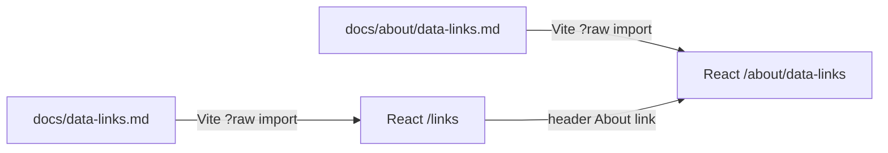

# About this page: Links

> **Last reviewed:** 2026-11-05 · **Owner:** Howard Isaacson
>
> Written from [the About template](../about-this-page-template.md) ([ADR 0009](../decisions/0009-about-this-page-for-every-section.md)).

The public page is `/links` on the React site. It renders [`docs/data-links.md`](../data-links.md) as the single source of truth ([ADR 0024](../decisions/0024-render-about-markdown-in-react.md)). That file is separate from the internal article list in [`docs/links.md`](../links.md).

## 1. Purpose
Shows visitors and interviewers exactly which upstream feeds TI uses or plans to use, with one-sentence descriptions and credit notes. It supports the provenance story in the data science workflow ([ADR 0016](../decisions/0016-data-science-workflow-as-first-class-feature.md)).

## 2. What you're seeing
- **Category headings:** solar wind, flares, Kp, alerts, orbits, solar images.
- **Link + one sentence** per feed or product page.
- **Credits and terms** for NOAA SWPC, GFZ (with DOI), CelesTrak, Space-Track, and solar-image providers.

This page is documentation, not a live data dashboard. Some listed sources (for example solar images) are not ingested yet; the markdown says so.

## 3. Data source & cadence
| Item | Value |
|---|---|
| Provider | Not a live feed. The page is documentation rendered from the repo. |
| Endpoint | Site route `/links`; About at `/about/data-links` |
| Format / access | Markdown imported at Vite build time (`?raw`) |
| Upstream update cadence | When `docs/data-links.md` changes and `web` is rebuilt |
| Processing level | Editorial. Outbound links open the providers' own sites. |

## 4. Data flow

## 5. How we built it
Same pattern as the workflow and About pages: one markdown file in `docs/`, no copied prose in React. The header and footer both link to `/links`. AGENTS.md requires updating this markdown whenever a data source is added or removed.

## 6. Limitations & caveats
- Link availability depends on the providers; TI does not mirror their sites.
- The two real-time solar-wind names open NOAA’s solar-wind product page (`/products/solar-wind`), not the JSON files the poller fetches. Some other entries still open a raw JSON or text file.
- Space-Track needs a free account. Those rows stay off the public site and the public API ([ADR 0035](../decisions/0035-what-may-be-shown-publicly.md)).
- KeepTrack is an outbound link to a public 3D tracker. The page does not ingest it.

## 7. Related reading
- [docs/data-links.md](../data-links.md)
- [docs/research/data_sources.md](../research/data_sources.md)
- [docs/links.md](../links.md) (internal reading list, not this page)
