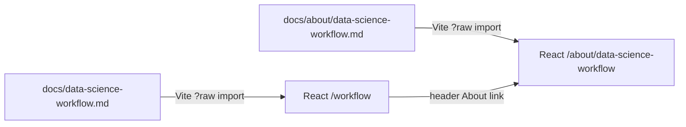

# About this page: How the science is done

> **Last reviewed:** 2026-10-29 · **Owner:** Howard Isaacson
>
> Written from [the About template](../about-this-page-template.md) ([ADR 0009](../decisions/0009-about-this-page-for-every-section.md)).

The public page is `/workflow` on the React site. It renders [`docs/data-science-workflow.md`](../data-science-workflow.md) as the single source of truth ([ADR 0016](../decisions/0016-data-science-workflow-as-first-class-feature.md), [ADR 0024](../decisions/0024-render-about-markdown-in-react.md)). This About file explains the page; it does not copy the workflow prose.

## 1. Purpose
Shows how Tachocline Industries turns a vague science question into a validated, monitored answer. The worked example is **Drag Watch** (orbital decay under solar activity). The audience is a visitor or interviewer who wants process, not only a chart.

## 2. What you're seeing
- **Mermaid flowchart:** the eleven workflow steps and the loops back to features and new questions.
- **Step table:** each step with the Drag Watch example, repo location, tools, and ADR links.
- **Interview talking points and reproducibility practices:** plain-language bullets for interviews and for how we keep work repeatable.

There is no live model output on this page yet. Status in the source doc is still “plan.”

## 3. Data source & cadence
| Item | Value |
|---|---|
| Provider | Not a live feed. The page is documentation rendered from the repo. |
| Endpoint | Site route `/workflow`; About at `/about/data-science-workflow` |
| Format / access | Markdown imported at Vite build time (`?raw`); Mermaid runs in the browser |
| Upstream update cadence | When `docs/data-science-workflow.md` changes and `web` is rebuilt |
| Processing level | Editorial / plan. Not an observation and not a prediction. |

## 4. Data flow

## 5. How we built it
Vite loads the workflow markdown the same way as About pages. Fenced `mermaid` blocks are rendered with the Mermaid library in the browser. Relative links to ADRs and research notes rewrite to GitHub blob URLs (or in-app About routes).

## 6. Limitations & caveats
- The workflow is a **plan**. Drag Watch model code is not shipped yet.
- Mermaid needs JavaScript; with JS off, the diagram appears as a code block.
- Wide tables may scroll horizontally inside the page; the page itself must not scroll the viewport sideways at 320 px.

## 7. Related reading
- [docs/data-science-workflow.md](../data-science-workflow.md)
- [ADR 0016](../decisions/0016-data-science-workflow-as-first-class-feature.md)
- [research/satellite_orbit_decay_data.md](../research/satellite_orbit_decay_data.md)
