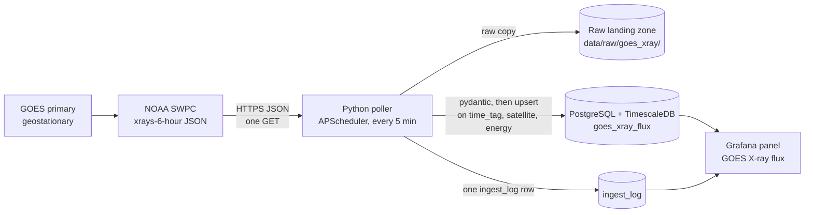

# About this page: GOES X-ray flux

> **Last reviewed:** 2026-10-26 · **Owner:** Howard Isaacson
>
> Written from [the About template](../about-this-page-template.md) ([ADR 0009](../decisions/0009-about-this-page-for-every-section.md)).

The panel lives on the Grafana dashboard **Solar wind** (uid `solar-wind`), under the Bz chart. There is no separate dashboard and no website page yet ([ADR 0007](../decisions/0007-grafana-now-react-later-for-frontend.md)). After `docker compose up`, open `http://127.0.0.1:3000` and the **Solar wind** dashboard. The dashboard link **About GOES X-ray** points here: [`docs/about/goes-xray.md`](https://github.com/howardisaacson/tachocline-industries/blob/main/docs/about/goes-xray.md).

## 1. Purpose
Shows how bright the Sun is in soft X-rays right now, which is how a solar flare is measured. A flare is a sudden brightening in that light. The panel is for someone watching the dashboard and for an interviewer asking how a second feed joined the first pipeline. The trace is a measurement NOAA SWPC publishes from GOES. It is the flux, labelled with flare class. SWPC's written alerts are a separate feed, written up in [Kp and alerts](kp-alerts.md).

## 2. What you're seeing
The dashboard window defaults to the last 24 hours, in UTC. This file only carries about six hours, so the chart is empty before the poller has been running, and it stays empty for any gap longer than that window.

- **GOES X-ray flux:** electron-corrected flux from `goes_xray_flux.flux` where `energy` is `0.1-0.8nm` · units: watts per square metre (W/m²) · the axis is log10, floored at 10⁻⁹ · coloured bands are the NOAA flare classes: A from 10⁻⁸, B from 10⁻⁷, C from 10⁻⁶, M from 10⁻⁵, X from 10⁻⁴ · a quiet Sun sits near A or B; C is a common small flare; M and X are the ones people notice. A null or zero flux is left off the chart so the logarithm stays defined. The one-minute bucket averages that channel. The short channel (`0.05-0.4nm`) is stored and is not drawn. If two satellites ever share a minute, the point is their average.

NOAA's product page for this measurement: [GOES X-ray flux](https://www.spaceweather.gov/products/goes-x-ray-flux).

## 3. Data source & cadence
| Item | Value |
|---|---|
| Provider | [NOAA Space Weather Prediction Center](https://www.spaceweather.gov/products/goes-x-ray-flux), primary GOES X-ray flux |
| Satellite(s) / instrument(s) | The spacecraft in the file's `satellite` field. On 2026-10-25 that was GOES-18 (`18`). The `primary` URL is SWPC's choice of satellite. We store the number and do not pick a spacecraft in code. |
| Endpoint | [`xrays-6-hour.json`](https://services.swpc.noaa.gov/json/goes/primary/xrays-6-hour.json). The 1-day, 3-day, and 7-day files, and `integral-protons-6-hour.json`, are not polled. |
| Format / access | JSON over HTTPS, no auth. `User-Agent` is `INGEST_USER_AGENT`. |
| Upstream update cadence | 1-minute records, rolling about 6 hours ([data_sources.md](../research/data_sources.md)) |
| Our polling cadence | `SWPC_POLL_MINUTES` (5 in `.env.example`), on startup and then on that interval. The solar-wind job uses the same number. |
| End-to-end latency | Not measured here. A minute already in the file waits for the next poll, then up to the 1-minute Grafana refresh. |
| Processing level | Real-time. `flux` is the electron-corrected value. `observed_flux` and `electron_correction` are stored beside it. The table comment calls these real-time rows, not a flare alert. |
| History we keep | Whatever the poller has upserted into the Docker volume `pgdata`. The upstream file does not carry the older day. Raw copies stay under `data/raw/goes_xray/<YYYY-MM-DD>/` until someone deletes them. There is no retention job. |

## 4. Data flow

SWPC publishes the JSON file. The poller saves the body unchanged, validates every object, and upserts into `goes_xray_flux`. The same run writes one `ingest_log` row with source `xrays-6-hour`. Grafana reads the table with the SELECT-only role. The solar-wind job is separate: a failure on one feed does not skip the other. This path has no continuous aggregate, no FastAPI route, and no React page.

## 5. Tech used and why
| Layer | Technology | Why (one line) | Decision |
|---|---|---|---|
| Ingestion | Python, httpx, pydantic, APScheduler 3.x | The same process adds a second interval job: fetch, land raw JSON, validate, upsert. | [ADR 0004](../decisions/0004-python-scheduled-pollers-with-raw-landing-zone.md) |
| Storage | PostgreSQL + TimescaleDB | Hypertable `goes_xray_flux`, primary key `(time_tag, satellite, energy)`, 7-day chunks. | [ADR 0005](../decisions/0005-postgresql-timescaledb-for-time-series-storage.md) |
| Visualisation | Grafana 13.2.4 | One full-width panel on the existing Solar wind dashboard: log axis and class bands. | [ADR 0007](../decisions/0007-grafana-now-react-later-for-frontend.md) |
| Runtime | Docker Compose | The existing `ingest` container. No new service. | [ADR 0002](../decisions/0002-build-locally-first-with-docker-compose.md), [ADR 0008](../decisions/0008-modular-monolith-before-microservices.md), [ADR 0014](../decisions/0014-when-to-use-more-than-one-docker-container.md) |

Key code: [`ingest/ti_ingest/goes_xray.py`](../../ingest/ti_ingest/goes_xray.py), [`ingest/ti_ingest/models.py`](../../ingest/ti_ingest/models.py) (`XrayRow`), [`ingest/ti_ingest/load.py`](../../ingest/ti_ingest/load.py), [`ingest/ti_ingest/__main__.py`](../../ingest/ti_ingest/__main__.py), [`db/migrations/0002_goes_xray_flux.sql`](../../db/migrations/0002_goes_xray_flux.sql), [`dashboards/json/solar-wind.json`](../../dashboards/json/solar-wind.json).

## 6. Known limitations
- No new rows while the local stack is off ([ADR 0002](../decisions/0002-build-locally-first-with-docker-compose.md)). The next run fetches the current file, which holds about six hours. An outage longer than that is a gap these files cannot fill. The 1-day and 7-day URLs are the same product with a longer window and are not polled yet.
- The JSON key for the contamination flag is `electron_contaminaton`. The column is `electron_contamination`. The model accepts both spellings. `flux`, `observed_flux`, and `electron_correction` are `double precision` so the stored value keeps the 64-bit number from the file.
- A missing required key is a rejected row (`rows_rejected`). An HTTP 4xx is logged and not retried. The next try is the next scheduled poll. A validation reject still leaves `ingest_log.error` null.
- If Postgres is down, the raw file stays on disk and that run is not upserted.
- The health stat on this dashboard reads every source in `ingest_log`. A GOES run that has never succeeded makes that stat say `no good ingest`, including when solar wind itself is fine.
- The chart draws only `0.1-0.8nm`. A new energy label would be stored and would not appear until the panel SQL names it.
- Narrow window: this panel is one more full-width row on the Solar wind dashboard. Below 640 px the page is taller. Grafana's own menu can crowd a 320 px window. No live browser check was done for this panel. The limit is the one already written on the dashboard and in [the solar-wind About page](solar-wind.md).
- `0002_goes_xray_flux.sql` is applied by recreating the migrate container (`docker compose up --force-recreate migrate`). A container that already exited successfully is not run again by a plain `docker compose up`. Until that file is applied, the panel's query has no table.

## 7. Interview talking points
- **30-second pitch:** NOAA SWPC publishes about six hours of 1-minute GOES X-ray flux, two energy bands per minute. A second job in the same Python process saves the raw JSON, checks each object with pydantic, and upserts Postgres on `(time_tag, satellite, energy)`. Grafana charts the 0.1–0.8 nm flux on a log axis with A/B/C/M/X bands. The number is a measurement. Flare class is a label for that number.
- **Hardest problem:** One timestamp is two rows. A key of `time_tag` alone would collapse the bands, and a key without `satellite` would overwrite GOES-18 when SWPC switches the primary spacecraft. The upsert makes the next poll replace those rows in place.
- **Trade-off I made:** Polling the verified 6-hour file every 5 minutes, on the solar-wind interval, keeps one cadence and one polite GET. A longer file would survive a longer outage. I left that for a later change. Protons, Kp, and alerts are other issues.
- **How I know it works:** `tests/test_goes_xray.py` mocks HTTP and the database. It checks the raw bytes, the upstream typo, a rerun that does not add a second copy of a band, a 404 that is not retried, and a database outage that still keeps the raw file. `tests/test_dashboards.py` checks the log axis and the class boundaries. CI runs ruff and pytest. I have not opened a live Grafana window for this panel.
- **If I had more time / at scale:** Poll `xrays-1-day.json` or `xrays-7-day.json` so a night with the laptop off is still inside the file. Kp and alerts, the geomagnetic response, are ingested in [Kp and alerts](kp-alerts.md).
- **Likely questions & my answers:**
  - Q: "Why is the primary key three columns?" A: "Each minute has a short band and a long band, and the satellite number is data. `(time_tag, satellite, energy)` is one measurement. `ON CONFLICT DO UPDATE` makes the next poll idempotent."
  - Q: "What is a flare class?" A: "It is a bin on the 0.1–0.8 nm flux. A is 10⁻⁸ W/m², and each letter is ten times the one before it. X is 10⁻⁴ and up. The chart draws those edges as horizontal bands on a log axis."
  - Q: "What if SWPC returns 429?" A: "That job logs the status and does not call again until the next interval. The solar-wind job is a different schedule entry, so this 429 does not cancel the wind and mag fetches."

## 8. Glossary
| Term | Plain-language meaning |
|---|---|
| GOES | Geostationary Operational Environmental Satellite. It sits over a fixed longitude and watches the Sun's X-rays all the time. |
| Soft X-ray flux | How much X-ray power from the Sun hits one square metre, in watts. "Soft" here means the longer of the two bands SWPC publishes, 0.1–0.8 nm. |
| Flare class | A label for that flux. A, B, C, M, and X are steps of ten, starting at 10⁻⁸ W/m² for A. |
| Electron correction | Electrons can land in the X-ray detector and look like extra light. `flux` is the value after SWPC subtracts that. `observed_flux` is the value before. |
| Upsert | Insert a row, or update it if that `(time_tag, satellite, energy)` is already there, so the next poll does not duplicate a minute. |
| Raw landing zone | The folder where the response is saved byte for byte before parsing. For this feed that is `data/raw/goes_xray/<YYYY-MM-DD>/`. |
