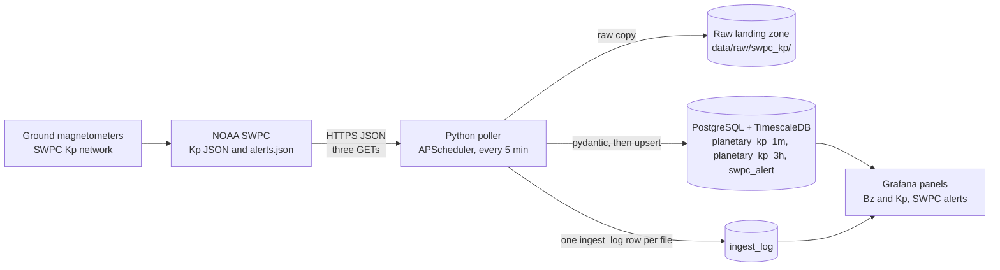

# About this page: Kp and SWPC alerts

> **Last reviewed:** 2026-10-25 · **Owner:** Howard Isaacson
>
> Written from [the About template](../about-this-page-template.md) ([ADR 0009](../decisions/0009-about-this-page-for-every-section.md)).

The panels live on the Grafana dashboard **Solar wind** (uid `solar-wind`), in the row directly under **Bz (GSM)**. The public page draws the same Kp as three radial clocks ([space-weather.md](space-weather.md)). After `docker compose up`, open `http://127.0.0.1:3000` and the **Solar wind** dashboard. The dashboard link **About Kp and alerts** points here: [`docs/about/kp-alerts.md`](https://github.com/howardisaacson/tachocline-industries/blob/main/docs/about/kp-alerts.md).

## 1. Purpose
Shows the geomagnetic response next to the solar-wind driver. Bz is the north–south magnetic field at L1. Kp is a planetary index of how disturbed Earth's magnetic field is. Alerts are the text SWPC issues when a threshold is crossed. The page is for someone watching the dashboard and for an interviewer asking how a second time series was joined to the first. The Kp traces and the alert text are real-time SWPC products. They are not the definitive GFZ Kp and they are not a forecast.

## 2. What you're seeing
The dashboard window defaults to the last 24 hours, in UTC. Scroll from **Bz (GSM)** and the next row is **Bz and Kp**. The alerts table is the row under that.

- **Bz and Kp:** three series on one time cursor. **Bz** is `rtsw_mag_1m.bz_gsm` for the active spacecraft, left axis, nanotesla (nT). **estimated Kp** is `planetary_kp_1m.estimated_kp`, right axis, orange, one-minute buckets. **3-hour Kp** is `planetary_kp_3h.kp`, same right axis, a purple step that holds until the next 3-hour point. The right axis runs from 0 to 9. A quiet field is near 0 to 3. [NOAA's scale page](https://www.spaceweather.gov/noaa-scales-explanation) pairs Kp 5 with a minor geomagnetic storm and Kp 9 with the top of that scale. Interesting when Bz is negative and Kp is climbing: southward Bz lets solar-wind energy in, and Kp is one way that disturbance is scored. The tooltip shows all three series together.
- **SWPC alerts:** up to eight rows from `swpc_alert` inside the dashboard time range, newest first. Columns are issue time, the short `product_id` (such as `K04A`), and the first 180 characters of the message. The full message, including the human-readable code and serial number, stays in the database.

NOAA's product pages: [planetary K-index](https://www.spaceweather.gov/products/planetary-k-index) and [alerts, watches, and warnings](https://www.spaceweather.gov/products/alerts-watches-and-warnings).

## 3. Data source & cadence
| Item | Value |
|---|---|
| Provider | [NOAA Space Weather Prediction Center](https://www.spaceweather.gov/products/planetary-k-index), real-time estimated Kp and real-time alerts |
| Satellite(s) / instrument(s) | Ground magnetometers, not a spacecraft. The 3-hour page names Sitka, Meanook, Ottawa, Fredericksburg, Hartland, Wingst, Niemegk, and Canberra. `station_count` on each 3-hour row is how many of them contributed. Bz on the same panel is still the L1 magnetic field from [solar wind](solar-wind.md). |
| Endpoint | [`planetary_k_index_1m.json`](https://services.swpc.noaa.gov/json/planetary_k_index_1m.json), [`noaa-planetary-k-index.json`](https://services.swpc.noaa.gov/products/noaa-planetary-k-index.json), and [`alerts.json`](https://services.swpc.noaa.gov/products/alerts.json). The aurora grid and the solar-cycle file are not polled. |
| Format / access | JSON over HTTPS, no auth. `User-Agent` is `INGEST_USER_AGENT`. |
| Upstream update cadence | 1-minute estimated Kp, 3-hour estimated Kp, and alerts when SWPC issues them ([data_sources.md](../research/data_sources.md)). On the 2026-10-25 check the 1-minute file held about six hours, the 3-hour file about seven days, and alerts.json messages back to 2026-09-26. |
| Our polling cadence | `SWPC_POLL_MINUTES` (5 in `.env.example`), on startup and then on that interval. One job fetches the three files. The solar-wind job and the GOES job use the same number and stay separate. |
| End-to-end latency | Not measured here. A row already in the file waits for the next poll, then up to the 1-minute Grafana refresh. |
| Processing level | Real-time. The 3-hour product page calls its index estimated. The 1-minute file's number is `estimated_kp`. The table comments say the same. This is not the later definitive Kp from GFZ. |
| History we keep | Whatever the poller has upserted into the Docker volume `pgdata`. Raw copies stay under `data/raw/swpc_kp/<YYYY-MM-DD>/` until someone deletes them. There is no retention job. |

## 4. Data flow

SWPC publishes the three JSON files. The poller saves each body unchanged, validates every object, and upserts. Kp uses `time_tag` as the key. An alert uses `(issue_datetime, product_id)`. The same run writes one `ingest_log` row per file it attempted. Grafana reads the tables with the SELECT-only role. Bz is not fetched again here; the panel queries `rtsw_mag_1m`, which the solar-wind job already fills. This path has no continuous aggregate and no React page. `GET /api/kp-1m`, `GET /api/kp-3h`, and `GET /api/alerts` read the same tables ([API](api.md)).

## 5. Tech used and why
| Layer | Technology | Why (one line) | Decision |
|---|---|---|---|
| Ingestion | Python, httpx, pydantic, APScheduler 3.x | A third interval job in the same process: fetch, land raw JSON, validate, upsert. | [ADR 0004](../decisions/0004-python-scheduled-pollers-with-raw-landing-zone.md) |
| Storage | PostgreSQL + TimescaleDB | Hypertables for 1-minute Kp, 3-hour Kp, and alerts. The unique key includes the time column. | [ADR 0005](../decisions/0005-postgresql-timescaledb-for-time-series-storage.md) |
| Visualisation | Grafana 13.2.4 | One full-width dual-axis panel under Bz, then a full-width alerts table. | [ADR 0007](../decisions/0007-grafana-now-react-later-for-frontend.md) |
| Runtime | Docker Compose | The existing `ingest` container. No new service. | [ADR 0002](../decisions/0002-build-locally-first-with-docker-compose.md), [ADR 0008](../decisions/0008-modular-monolith-before-microservices.md), [ADR 0014](../decisions/0014-when-to-use-more-than-one-docker-container.md) |

Key code: [`ingest/ti_ingest/kp_alerts.py`](../../ingest/ti_ingest/kp_alerts.py), [`ingest/ti_ingest/models.py`](../../ingest/ti_ingest/models.py) (`Kp1mRow`, `Kp3hRow`, `AlertRow`), [`ingest/ti_ingest/load.py`](../../ingest/ti_ingest/load.py), [`ingest/ti_ingest/__main__.py`](../../ingest/ti_ingest/__main__.py), [`db/migrations/0003_kp_alerts.sql`](../../db/migrations/0003_kp_alerts.sql), [`dashboards/json/solar-wind.json`](../../dashboards/json/solar-wind.json).

## 6. Known limitations
- No new rows while the local stack is off ([ADR 0002](../decisions/0002-build-locally-first-with-docker-compose.md)). On the 2026-10-25 check the 1-minute file held about six hours. An outage longer than that window is a gap that file cannot fill. The 3-hour file held about seven days, so a short outage can still be inside it.
- The JSON key for 3-hour Kp is `Kp`. The column is `kp`. A missing required key is a rejected row (`rows_rejected`). An HTTP 4xx is logged and not retried. HTTP 429 skips the rest of that Kp/alerts run. The next try is the next scheduled poll. A validation reject still leaves `ingest_log.error` null.
- `estimated_kp` and the 3-hour `kp` are `double precision` so the stored value keeps the 64-bit number from the file. `kp_index`, `a_running`, and `station_count` are integers. A non-integer in those fields is a rejected row.
- If Postgres is down, the raw files stay on disk and that run is not upserted.
- The health stat on this dashboard reads the 5-minute sources in `ingest_log` and skips `gp-*`. A Kp run that has never succeeded makes that stat say `no good ingest`, including when solar wind itself is fine. A failed orbit poll does not.
- The alerts table follows the dashboard time range and shows eight rows. Older messages stay in `swpc_alert` and in the raw file. The cell is the first 180 characters.
- Narrow window: these panels are two more full-width rows under Bz. Below 640 px the page is taller. The Kp axis stays on the right; it is not swapped for a stacked mobile chart. Grafana's own menu can crowd a 320 px window. No live browser check was done for these panels. The limit is the one already written on the dashboard and in [the solar-wind About page](solar-wind.md).
- `0003_kp_alerts.sql` is applied when the migrate container runs again. A container that already exited successfully is not run again by a plain `docker compose up` unless the image change makes Compose recreate it. Until that file is applied, the new panels' queries have no tables.

## 7. Interview talking points
- **30-second pitch:** NOAA SWPC publishes a 1-minute estimated Kp, an estimated 3-hour Kp, and a list of alert messages. A third job in the same Python process saves each raw JSON file, checks each object with pydantic, and upserts Postgres. Kp's key is the timestamp. An alert's key is the issue time plus the product code. Grafana draws Bz and both Kp series on one panel so you can see the driver and the response together. The numbers are real-time estimates, not the final GFZ index.
- **Hardest problem:** One minute of planetary Kp is one row, so `time_tag` is enough. An alert's product code repeats, so the key has to include the issue time. Both keys include time because a Timescale hypertable requires that. The next poll replaces those rows in place.
- **Trade-off I made:** Polling the three verified files every 5 minutes, on the solar-wind interval, keeps one cadence. A 429 stops the rest of that run so we do not hammer SWPC. The aurora grid in the same research note is a different shape and is not in this job.
- **How I know it works:** `tests/test_kp_alerts.py` mocks HTTP and the database. It checks the raw bytes, the capital `Kp` key, a rerun that does not add a second copy, a 404 that still fetches the other files, a 429 that skips them, and a database outage that still keeps the raw files. `tests/test_dashboards.py` checks that the Kp panel is the next row after Bz and that Kp uses the right axis. CI runs ruff and pytest. I have not opened a live Grafana window for this panel.
- **If I had more time / at scale:** Keep a longer 1-minute history than the upstream file holds, by never deleting what we have already upserted. The briefing agent in the roadmap can read `swpc_alert` once the read API exists.
- **Likely questions & my answers:**
  - Q: "Why is Bz on the same panel as Kp?" A: "Bz is a cause people watch, Kp is a scored effect. Sharing the time cursor is the correlation. They stay on separate axes because nanotesla and a 0-to-9 index are different units."
  - Q: "Is this the official Kp?" A: "It is NOAA SWPC's real-time estimate. The 3-hour product page says estimated. GFZ publishes the definitive index later. The chart does not label the estimate as that final number."
  - Q: "What if SWPC returns 429?" A: "That job logs the status and does not call the remaining Kp or alert URLs until the next interval. The solar-wind job and the GOES job are different schedule entries, so this 429 does not cancel them."

## 8. Glossary
| Term | Plain-language meaning |
|---|---|
| Kp | A planetary index from 0 to 9 for how disturbed Earth's magnetic field is. Each step is a third (0, 0.33, 0.67, 1, …). |
| Estimated Kp | SWPC's real-time version of that index, updated from ground magnetometers before the definitive value is settled. |
| Bz | North–south component of the solar magnetic field at L1. Negative means southward. Unit: nanotesla. |
| Alert | A text message SWPC issues when a measured threshold is crossed. A watch is issued ahead of a predicted threshold. Both land in `alerts.json`. |
| Upsert | Insert a row, or update it if that key is already there, so the next poll does not duplicate a minute or an alert. |
| Raw landing zone | The folder where the response is saved byte for byte before parsing. For this feed that is `data/raw/swpc_kp/<YYYY-MM-DD>/`. |
