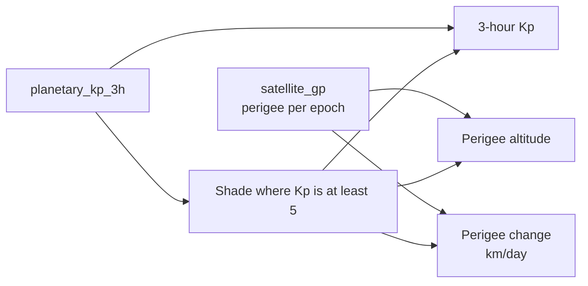

# About this page: Orbit decay

> **Last reviewed:** 2026-10-25 · **Owner:** Howard Isaacson
>
> Written from [the About template](../about-this-page-template.md) ([ADR 0009](../decisions/0009-about-this-page-for-every-section.md)).

The panels are the Grafana dashboard **Orbit decay** (uid `orbit-decay`). It is a separate dashboard from **Solar wind**, so the storm bands do not cover the solar-wind charts. After `docker compose up`, open `http://127.0.0.1:3000` and choose **Orbit decay**. Grafana's file provider polls `dashboards/json` every 30 seconds, so a new file in that directory shows up without recreating the container. The dashboard link **About this page** points here: [`docs/about/orbit-decay.md`](https://github.com/howardisaacson/tachocline-industries/blob/main/docs/about/orbit-decay.md).

## 1. Purpose
Puts satellite perigee next to geomagnetic activity. The question is whether storm periods line up with a faster drop in altitude. The page is for someone looking at that hypothesis, and for an interviewer asking how a rate is computed from a time series. The altitudes are two-body perigees from real-time mean elements. The Kp trace is NOAA SWPC's real-time estimate. Neither is a forecast, and the rate is not a fitted drag model.

## 2. What you're seeing
The dashboard window defaults to the last 7 days, in UTC. Red shaded bands are annotations on every panel.

- **Perigee altitude:** five series, kilometers. ISS (NORAD 25544), Landsat 8 (39084), Landsat 9 (49260), HST (20580), and Swift (28485). Dots are on because a two-hour series can be a single point, and a line with no dots would hide it. A jump upward on the station is what a reboost looks like. A steady decline is what drag looks like. Apogee stays in `satellite_gp` and is not plotted. Interesting when Swift's perigee is falling while the station's is flat or rising.
- **Perigee change:** the same five satellites, in kilometers per day. Zero is the center of the axis. Negative means perigee fell between this epoch and the previous one. The first epoch for a satellite is absent here, because a slope needs two points. Until the second poll lands, this panel is empty. That is the measurement, not a broken query.
- **3-hour Kp:** `planetary_kp_3h.kp`, axis 0 to 9, with a horizontal line at 5. [NOAA's scale page](https://www.spaceweather.gov/noaa-scales-explanation) pairs Kp 5 with a minor geomagnetic storm (G1) and Kp 9 with the top of that scale. The shaded band uses the same rows: it starts at `time_tag` and lasts three hours. Quiet stretches have no band.

How the element sets are produced is [satellite GP](satellite-gp.md). How the Kp file is produced is [Kp and alerts](kp-alerts.md).

## 3. Data source & cadence
| Item | Value |
|---|---|
| Provider | CelesTrak GP for altitude; [NOAA SWPC](https://www.spaceweather.gov/products/planetary-k-index) for estimated 3-hour Kp |
| Satellite(s) / instrument(s) | NORAD 25544, 39084, 49260, 20580, 28485. Kp is ground magnetometers, not a spacecraft. |
| Endpoint | The charts read Postgres. The pollers are the ones in [satellite GP](satellite-gp.md) and [Kp and alerts](kp-alerts.md). |
| Format / access | Grafana uses the read-only role. The queries are `SELECT` only. |
| Upstream update cadence | GP data is checked by CelesTrak every 2 hours. The 3-hour Kp file updates through the day. |
| Our polling cadence | Orbit job every 120 minutes. Kp job every `SWPC_POLL_MINUTES`. |
| End-to-end latency | Not measured. A new element set waits for the next orbit poll. The dashboard refresh is 5 minutes. |
| Processing level | Real-time mean elements and real-time estimated Kp. The rate is derived. This is not SGP4 and not the definitive GFZ Kp. |
| History we keep | Epochs upserted since the orbit poller started. There is no Space-Track backfill, so the chart does not show the years before the first successful poll. |

## 4. Data flow

The orbit poller and the Kp poller fill the two tables. This dashboard does not fetch anything. Perigee is the column already stored. The rate is computed in the panel query: subtract the previous perigee from this one, and divide by the number of days between the epochs. The window function runs on that satellite's full history, and the dashboard time range is applied afterward, so a point just inside the window can still see the epoch just before it. The shade is a Grafana annotation, which is a time region drawn on top of the panels. This page has no continuous aggregate and no React page. `GET /api/satellite-perigee` and `GET /api/kp-3h` read the same tables ([API](api.md)). The rate stays in the dashboard query.

## 5. Tech used and why
| Layer | Technology | Why (one line) | Decision |
|---|---|---|---|
| Visualisation | Grafana 13.2.4 | Three full-width panels and a time-region annotation. `schemaVersion` stays 39. | [ADR 0007](../decisions/0007-grafana-now-react-later-for-frontend.md) |
| Storage | PostgreSQL + TimescaleDB | The charts read `satellite_gp` and `planetary_kp_3h`. The rate is not a new table. | [ADR 0005](../decisions/0005-postgresql-timescaledb-for-time-series-storage.md) |
| Runtime | Docker Compose | The existing Grafana container. The JSON is a new file in the directory it already mounts. | [ADR 0002](../decisions/0002-build-locally-first-with-docker-compose.md) |

Key code: [`dashboards/json/orbit-decay.json`](../../dashboards/json/orbit-decay.json). The numbers it plots come from [`db/migrations/0004_satellite_gp.sql`](../../db/migrations/0004_satellite_gp.sql) and [`db/migrations/0003_kp_alerts.sql`](../../db/migrations/0003_kp_alerts.sql).

## 6. Known limitations
- One epoch cannot draw a rate. The second point appears after the next successful two-hour poll for that catalog number. A laptop that is off collects neither point ([ADR 0002](../decisions/0002-build-locally-first-with-docker-compose.md)).
- The rate is the change in the two-body perigee, not an SGP4 state and not a measured height. A new element set can move because the fit changed, not only because the satellite did. Treat a single step with that in mind.
- The shade assumes `time_tag` is the start of a three-hour block. The band is `time_tag` through `time_tag + 3 hours` for rows with `kp >= 5`. A quiet week has no bands. The 1-minute estimated Kp is not used for the shade, because the NOAA scale is the 3-hour index.
- Kp and altitude are on one dashboard so the bands cross both charts. They are not a statistical test. A storm band sitting on a drop is a picture, not a fitted effect.
- There is no history before the poller started. Space-Track `gp_history` was left optional.
- Narrow window: three full-width charts plus a note. Five series stay in the legend below 640 px. No live browser check was done. Grafana's menu can crowd a 320 px window.
- The file provider polls every 30 seconds. Editing this JSON does not require recreating Grafana. A bind mount does not always emit a watch event, which is why the interval is 30 rather than 10.

## 7. Interview talking points
- **30-second pitch:** Five satellites have a stored perigee at each element epoch. A second dashboard plots that perigee, the change in kilometers per day, and the 3-hour Kp. When Kp is at least 5, Grafana shades those three hours on every panel. The slope is a window over consecutive epochs. The first epoch has no slope, so an empty rate panel after the first poll is expected.
- **Hardest problem:** The time filter has to sit outside the window function. If the filter ran first, the oldest point on screen would lose the epoch just before the window, and the slope would be wrong or missing. The inner query keeps one satellite's history, and `$__timeFilter` is on the outer query.
- **Trade-off I made:** Perigee only, five lines, on its own dashboard. Apogee would double the legend. Putting the bands on the solar-wind dashboard would paint storm regions on speed and Bz too. The join lives here.
- **How I know it works:** `tests/test_orbit_decay_dashboard.py` reads the JSON. It checks the five catalog numbers, the lag formula, the Kp threshold, the annotation columns `time` and `timeend`, full-width rows, and that every query is a `SELECT`. It does not start Grafana. I have not opened this dashboard in a browser.
- **If I had more time / at scale:** Backfill element history, then ask whether the storm bands actually coincide with steeper negative slopes. That is a later model, with a held-out set of decays, not a threshold painted on a chart.
- **Likely questions & my answers:**
  - Q: "Why is the rate panel empty?" A: "A derivative needs two times. The first stored epoch is only a height. The next poll, two hours later, is the first slope."
  - Q: "Does a red band mean the storm caused the drop?" A: "No. The band is Kp at least 5, which NOAA calls a minor storm. The chart puts that interval on the same time axis as the altitude. It does not estimate an effect."
  - Q: "Why kilometers per day?" A: "The epoch gap is a fraction of a day. Dividing the kilometer change by that fraction makes a Swift drop readable next to a station that barely moves in two hours."

## 8. Glossary
| Term | Plain-language meaning |
|---|---|
| Perigee altitude | Lowest point of the orbit, kilometers above Earth's equatorial radius. Here it is computed from mean motion and eccentricity. |
| dh/dt | How fast the height changes. On this page, the change in perigee divided by the days between two epochs. |
| Kp | A 0-to-9 index of geomagnetic activity. The 3-hour estimated value is what this dashboard shades. |
| Annotation | A Grafana time region drawn across the panels. Here it marks three hours when Kp was at least 5. |
| Window function | A SQL calculation that sees the previous row, such as `LAG`, without collapsing the rows into one. |
