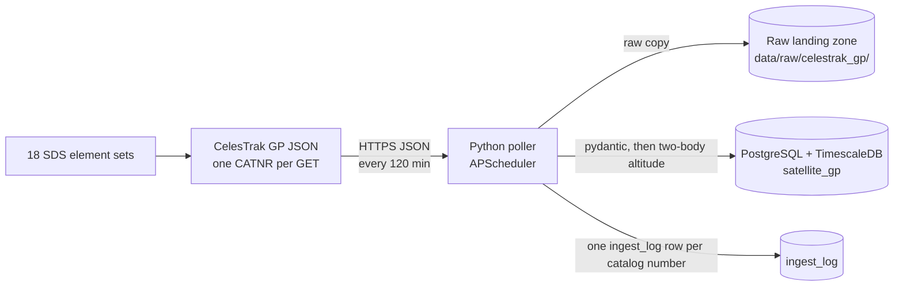

# About this page: Satellite GP history

> **Last reviewed:** 2026-10-25 · **Owner:** Howard Isaacson
>
> Written from [the About template](../about-this-page-template.md) ([ADR 0009](../decisions/0009-about-this-page-for-every-section.md)).

The rows live in `satellite_gp`. Perigee and its change over time are drawn on the **Orbit decay** dashboard ([orbit-decay.md](orbit-decay.md)). The Solar wind dashboard still links here, and its health stat leaves these rows out on purpose. After `docker compose up`, open `http://127.0.0.1:3000` and the **Orbit decay** dashboard. The link **About satellite GP** is on both dashboards: [`docs/about/satellite-gp.md`](https://github.com/howardisaacson/tachocline-industries/blob/main/docs/about/satellite-gp.md).

## 1. Purpose
Keeps a history of general perturbations (GP) for five satellites and stores a perigee and apogee altitude derived from each element set. The set is the International Space Station, Landsat 8, Landsat 9, the Hubble Space Telescope, and NASA Swift ([tracked-satellites.md](../research/tracked-satellites.md)). The page is for someone asking where the orbit numbers come from, and for an interviewer asking how a TLE becomes an altitude. These are real-time mean elements. They are not an SGP4 ephemeris and not a measured height.

## 2. What you're seeing
On **Orbit decay**, perigee is the top chart and the change in perigee is the chart under it. The health stat on **Solar wind**, **Minutes since last good ingest**, still describes the 5-minute space-weather feeds. A `gp-*` source is written to `ingest_log` and then ignored by that query, because a healthy orbit poll is two hours old and would otherwise paint the 5-minute stat red.

The stored altitudes are kilometers above Earth's equatorial radius. For a nearly circular orbit, perigee and apogee are close. A jump up on the station is consistent with a reboost, and a steady drop on Swift is consistent with drag. Swift was still in orbit on the 2026-10-25 catalog check, with no SATCAT decay date.

## 3. Data source & cadence
| Item | Value |
|---|---|
| Provider | [CelesTrak](https://celestrak.org/NORAD/documentation/gp-data-formats.php), current GP data redistributed from the 18th Space Defense Squadron |
| Satellite(s) / instrument(s) | NORAD 25544 ISS (ZARYA), 39084 LANDSAT 8, 49260 LANDSAT 9, 20580 HST, 28485 SWIFT |
| Endpoint | One URL per catalog number: `https://celestrak.org/NORAD/elements/gp.php?CATNR=<id>&FORMAT=json`. Not `GROUP=active`. |
| Format / access | JSON over HTTPS, no auth. `User-Agent` is `INGEST_USER_AGENT`. `FORMAT=json` is required: the default became CSV in May 2026. |
| Upstream update cadence | CelesTrak checks for new GP data once every two hours ([gp-data-formats.php](https://celestrak.org/NORAD/documentation/gp-data-formats.php)). |
| Our polling cadence | Every 120 minutes, on startup and then on that interval. The number is `POLL_MINUTES` in `celestrak_gp.py`. It does not read `SWPC_POLL_MINUTES`. |
| End-to-end latency | Not measured here. A new element set waits for the next two-hour poll. |
| Processing level | Real-time mean elements (OMM JSON). Perigee and apogee are derived. Space-Track `gp_history` is not fetched. |
| History we keep | Whatever the poller has upserted into the Docker volume `pgdata`, from the first successful run forward. Raw copies stay under `data/raw/celestrak_gp/<YYYY-MM-DD>/`. There is no retention job and no backfill. |

### TLE and element-set references
Checked 2026-10-25; each returned HTTP 200.

- [CelesTrak: Two-Line Element Set Format](https://celestrak.org/NORAD/documentation/tle-fmt.php) is the column layout of a TLE, including mean motion (revolutions per day) and eccentricity.
- [CelesTrak: General Perturbation Element Sets](https://celestrak.org/NORAD/documentation/gp-data-formats.php) is the GP query API, the JSON field names, and the two-hour rate rule.
- [Spacetrack Report No. 3](https://celestrak.org/NORAD/documentation/spacetrk.pdf) (Hoots and Roehrich) is the original SGP4/SDP4 write-up.
- [Revisiting Spacetrack Report #3](https://celestrak.org/publications/AIAA/2006-6753/AIAA-2006-6753.pdf) (Vallado, Crawford, Hujsak, and Kelso, AIAA 2006-6753) explains that a TLE mean motion is a Kozai mean motion and how SGP4 converts it.
- [CCSDS Orbit Data Messages](https://ccsds.org/Pubs/502x0b3e1.pdf) (502.0-B-3) is the OMM standard behind the JSON keywords (`EPOCH`, `MEAN_MOTION`, `NORAD_CAT_ID`).
- [NASA Earth Fact Sheet](https://nssdc.gsfc.nasa.gov/planetary/factsheet/earthfact.html) supplies the constants used for altitude: GM `0.39860 × 10^6` km³/s² and equatorial radius 6378.137 km.

## 4. Data flow

CelesTrak publishes one JSON array per catalog number. The poller saves each body unchanged, validates the object, computes perigee and apogee, and upserts on `(epoch, norad_cat_id)`. The same run writes one `ingest_log` row per catalog number it attempted. Grafana's health query skips sources whose names start with `gp-`. The **Orbit decay** dashboard reads `satellite_gp` and `planetary_kp_3h`. This path has no continuous aggregate and no React page. `GET /api/satellite-perigee` returns the two altitudes ([API](api.md)). Space-Track is not in the diagram: `gp_history` needs an account and this issue leaves that backfill optional.

## 5. Tech used and why
| Layer | Technology | Why (one line) | Decision |
|---|---|---|---|
| Ingestion | Python, httpx, pydantic, APScheduler 3.x | A fourth interval job in the same process: fetch, land raw JSON, validate, upsert. | [ADR 0004](../decisions/0004-python-scheduled-pollers-with-raw-landing-zone.md) |
| Storage | PostgreSQL + TimescaleDB | One hypertable. The unique key includes the element epoch. | [ADR 0005](../decisions/0005-postgresql-timescaledb-for-time-series-storage.md) |
| Altitude | Two-body formula in Python | The JSON has mean motion and eccentricity, not altitude. SGP4 can wait until a chart needs a position. | Same poller pattern as the SWPC jobs. Not a new ADR. |
| Runtime | Docker Compose | The existing `ingest` container. No new service. | [ADR 0002](../decisions/0002-build-locally-first-with-docker-compose.md), [ADR 0008](../decisions/0008-modular-monolith-before-microservices.md), [ADR 0014](../decisions/0014-when-to-use-more-than-one-docker-container.md) |

Key code: [`ingest/ti_ingest/celestrak_gp.py`](../../ingest/ti_ingest/celestrak_gp.py), [`ingest/ti_ingest/elements.py`](../../ingest/ti_ingest/elements.py), [`ingest/ti_ingest/models.py`](../../ingest/ti_ingest/models.py) (`GpRow`), [`ingest/ti_ingest/load.py`](../../ingest/ti_ingest/load.py), [`ingest/ti_ingest/__main__.py`](../../ingest/ti_ingest/__main__.py), [`db/migrations/0004_satellite_gp.sql`](../../db/migrations/0004_satellite_gp.sql).

## 6. Known limitations
- No new rows while the local stack is off ([ADR 0002](../decisions/0002-build-locally-first-with-docker-compose.md)). There is no Space-Track `gp_history` backfill, so a gap stays a gap. `SPACETRACK_USER` and `SPACETRACK_PASSWORD` in `.env.example` are unused.
- The altitude is two-body: `n` in radians per second is mean motion times `2π / 86400`, `a = (μ / n²)^(1/3)`, perigee is `a(1-e) − R`, apogee is `a(1+e) − R`. μ is 398600.0 km³/s² and R is 6378.137 km, from the NASA fact sheet. A TLE mean motion is Kozai. SGP4 converts it before propagating ([AIAA 2006-6753](https://celestrak.org/publications/AIAA/2006-6753/AIAA-2006-6753.pdf)). The difference is small beside a reboost. Do not quote these kilometers as an SGP4 state.
- A 4xx is logged and not retried. HTTP 429 skips the catalog numbers still left in that run. The next try is two hours later. The solar-wind, GOES, and Kp jobs are separate schedule entries.
- If Postgres is down, the raw files stay on disk and that run is not upserted.
- The health stat excludes `gp-%`. A failed orbit poll does not turn that 5-minute panel red, and it also does not turn it to `no good ingest`. Orbit health is the `gp-*` rows in `ingest_log`.
- `0004_satellite_gp.sql` is applied when the migrate container runs again. A container that already exited successfully is not run again by a plain `docker compose up` unless the image change makes Compose recreate it.
- Narrow window: the altitude charts are full-width rows on **Orbit decay**. Five series stay on the legend below 640 px. No live browser check was done for that dashboard.

## 7. Interview talking points
- **30-second pitch:** CelesTrak publishes a current element set per satellite as JSON. A job in the same Python process downloads five catalog numbers every two hours, saves the raw files, and upserts one row per epoch and NORAD id. The file has no altitude, so perigee and apogee are computed from mean motion and eccentricity with the two-body formula and NASA's Earth constants. That is a mean-element altitude, not an SGP4 position.
- **Hardest problem:** The natural key has to include time because the table is a Timescale hypertable, and the same epoch must not become a second row on the next poll. `(epoch, norad_cat_id)` does both. The two-hour cadence is a separate scheduler job so a 5-minute space-weather setting cannot hammer CelesTrak.
- **Trade-off I made:** Two-body altitude now, SGP4 later. The JSON already carries everything the simple formula needs, and the tests lock three known results. Propagating a position is a different question from "how high is perigee."
- **How I know it works:** `tests/test_celestrak_gp.py` mocks HTTP and the database. It checks five GETs, the raw bytes, the User-Agent, a 404 that continues, a 429 that stops, a rerun that does not add a row, a database outage that keeps the files, and a 120-minute interval. The altitude asserts use literals, not a second call that would hide a bug in the formula. CI runs ruff and pytest.
- **If I had more time / at scale:** Backfill with Space-Track `gp_history` once there is an account, so the Orbit decay chart has more than the epochs collected since the poller started. SGP4 belongs there if the question becomes "where is it," not "what is the element-set altitude."
- **Likely questions & my answers:**
  - Q: "Why not poll with the solar-wind interval?" A: "CelesTrak's own page says GP data is checked every two hours, and more than 50 client errors in two hours can firewall the IP. The orbit job is hardcoded to 120 minutes. `SWPC_POLL_MINUTES` stays at 5 for the space-weather files."
  - Q: "Where is the altitude in the TLE?" A: "It is not a field. Mean motion gives the semi-major axis, eccentricity splits that into perigee and apogee, and subtracting Earth's equatorial radius gives altitude. The layout is on CelesTrak's TLE format page."
  - Q: "Is this SGP4?" A: "No. SGP4 starts from the same elements and applies the Kozai-to-osculating conversion plus drag. These columns are the two-body altitudes of the published mean elements."

## 8. Glossary
| Term | Plain-language meaning |
|---|---|
| TLE | Two-line element set. Two lines of numbers that describe an orbit at one epoch. |
| GP | General perturbations. The element set CelesTrak serves, as a TLE, a JSON object, or a CSV row. |
| OMM | Orbit mean-elements message. The CCSDS names for those same fields (`MEAN_MOTION`, `ECCENTRICITY`, `EPOCH`). |
| Mean motion | How many revolutions the satellite makes per day. Faster means a lower orbit. |
| Perigee / apogee | Lowest and highest points of the orbit. Here, kilometers above Earth's equatorial radius. |
| NORAD catalog number | The integer id of one tracked object. ISS is 25544. |
| Upsert | Insert a row, or update it if `(epoch, norad_cat_id)` is already there, so a rerun does not duplicate it. |
| Hypertable | A TimescaleDB table split into time chunks. Its unique key has to include the time column. |
