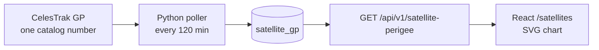

# About this page: Satellite Tracking

> **Last reviewed:** 2026-11-01 · **Owner:** Howard Isaacson
>
> Written from [the About template](../about-this-page-template.md) ([ADR 0009](../decisions/0009-about-this-page-for-every-section.md)).

The page is `/satellites`. The header link **Satellite Tracking** opens it. This file is the About doc at `/about/satellite-tracking`. Grafana's **Orbit decay** dashboard still has the internal chart, including the rate and the Kp bands. This page draws only perigee.

## 1. Purpose
Shows whether the five satellites we already poll are losing altitude. The page is for a visitor who wants the recent perigee, and for an interviewer asking why drag matters. The numbers are two-body perigee from real-time mean elements. They are not an SGP4 position and not a re-entry forecast.

## 2. What you're seeing
The header says why the chart exists: air drag lowers perigee, and a geomagnetic storm can speed that up. A jump up on the station is what a reboost looks like. A steady drop on Hubble or Swift is what drag looks like.

- **Perigee altitude:** kilometers, last 7 days, UTC. Five series: ISS (25544), Landsat 8 (39084), Landsat 9 (49260), HST (20580), Swift (28485). Landsat 9 is dashed because the two Landsats sit at nearly the same height. Dots are on because the poll is every two hours. The legend gives the latest stored perigee. Empty means the API returned no row in the window.
- **Links under the plot:** each satellite has a tracking page (N2YO, a sky-track site, not our data) and a NASA homepage. The altitude itself comes from CelesTrak.

## 3. Data source & cadence
| Item | Value |
|---|---|
| Provider | [CelesTrak](https://celestrak.org/) GP. The page reads our API, not CelesTrak. |
| Satellite(s) / instrument(s) | NORAD 25544, 39084, 49260, 20580, 28485 |
| Endpoint | `GET /api/v1/satellite-perigee` with `from`, `to`, and `limit=2000` |
| Format / access | JSON, same origin, no auth |
| Upstream update cadence | CelesTrak checks GP data about every 2 hours |
| Our polling cadence | Every 120 minutes |
| End-to-end latency | Not measured. A new element set waits for the next poll. |
| Processing level | Real-time mean elements. Altitude is derived. |
| History we keep | The chart asks for 7 days, which is the longest window this route allows. Older epochs stay in `satellite_gp`. |

## 4. Data flow

The poller saves the raw JSON, computes perigee, and upserts on epoch and catalog number. The page requests the last 7 days and draws those rows. It does not open Postgres.

## 5. Tech used and why
| Layer | Technology | Why (one line) | Decision |
|---|---|---|---|
| API | FastAPI | The browser never gets a database login | [ADR 0006](../decisions/0006-fastapi-for-backend-api.md) |
| Visualisation | React + SVG | One line chart, readable axis labels, no chart library | [ADR 0034](../decisions/0034-svg-perigee-chart-on-the-public-site.md) |
| Runtime | nginx | Same origin for `/api` | [ADR 0021](../decisions/0021-react-vite-page-with-svg-radial-plots.md) |

Key code: `web/src/satellites.js`, `web/src/PerigeeChart.jsx`, `web/src/SatellitesPage.jsx`, `api/ti_api/main.py` (`satellite_perigee`).

## 6. Known limitations
- The route rejects a window longer than 7 days, so this chart cannot show the months before that.
- The chart asks only for rows tagged `celestrak`. Space-Track history can sit in the same table and is not drawn here ([ADR 0035](../decisions/0035-what-may-be-shown-publicly.md)). Rows from before that tag existed are labeled `celestrak` only when `ingest_log` has no successful `gp-hist-*` run.
- The altitude is two-body, not SGP4. A reboost and a bad element set can both look like a jump.
- N2YO and the NASA homepages are outbound links. They are not the source of the plotted kilometers.
- No data when the local machine is off ([ADR 0002](../decisions/0002-build-locally-first-with-docker-compose.md)).

## 7. Interview talking points
- **30-second pitch:** Drag lowers perigee, and storms can speed it up. The public page asks FastAPI for the last 7 days of two-body perigee for five catalog numbers and draws that as an SVG line chart. Grafana still has the internal dashboard.
- **Trade-off I made:** SVG instead of Plotly, so the page stays small and the axis math is a few lines.
- **How I know it works:** `web/src/satellites.test.js` checks the window, the five ids, and that a higher perigee sits higher on the chart. Playwright checks the nav and the page at 320, 375, and 1280.
- **Likely questions & my answers:**
  - Q: "Why is the chart only a week long?" A: "The perigee route rejects anything longer than 7 days. A longer public chart needs a wider window, and it still has to leave Space-Track rows out."

## 8. Glossary
| Term | Plain-language meaning |
|---|---|
| Perigee | The low point of the orbit. Here, kilometers above Earth's equatorial radius. |
| Drag | The slowing force from the thin air in low Earth orbit. It makes perigee fall. |
| Reboost | A burn that lifts the station. It looks like a jump up, not like drag. |
