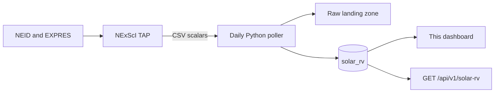

# About this page: Solar radial velocity

> **Last reviewed:** 2026-11-05 · **Owner:** Howard Isaacson
>
> Written from [the About template](../about-this-page-template.md) ([ADR 0009](../decisions/0009-about-this-page-for-every-section.md)).

Grafana dashboard **Solar radial velocity**. The same rows are drawn on the public home page. This file is the internal view.

## 1. Purpose
Shows the Sun-as-a-star radial velocity and the spectral SNR from NEID and EXPRES for the last 7 days. Velocity is in meters per second. SNR is `extsnr`, per pixel. It is for checking that the daily TAP pull landed, and for an interviewer asking why the chart is one number per exposure rather than a spectrum.

## 2. What you're seeing
- **Radial velocity:** `rv_m_s` against UTC. NEID and EXPRES are two series. Each exposure is one point, and the points are not connected, so a missing exposure stays a gap. This panel follows the dashboard time picker, which opens on the last 7 days. The public home-page chart asks for the same 7 days, keeps the 24 hours ending at the newest exposure, and draws a scatter. Its time axis runs from 30 minutes before that exposure to 30 minutes after it. Points are not connected. Hovering it writes the nearest UTC time, velocity, and SNR under the plot.
- **Spectral SNR:** `snr` against UTC, on the panel below. This is archive `extsnr`, per pixel. Each exposure is one point, and the points are not connected. A null SNR is omitted. The panel still draws a row whose velocity was stored as a gap. On the public chart the same number is the point color: dim blue is the lowest SNR in view, yellow is the highest, and gray means no SNR was published. The public point outline stays the instrument. Checked 2026-11-05, the stored NEID values ran from 0 to 339.7 per pixel, with a median of 328.7, so most points sit at the bright end and the dim points are the low-SNR tail.
- Units: meters per second for velocity. SNR is per pixel, not a velocity. A quiet solar velocity in the rows checked on 2026-11-05 sat near −640 m/s. Interesting when one instrument jumps relative to the other, when a series disappears, or when SNR drops while the velocity line continues.
- The uncertainty is stored and not drawn on this dashboard.

## 3. Data source & cadence
| Item | Value |
|---|---|
| Provider | [NExScI Solar RV Archive](https://neid.ipac.caltech.edu/search_solar.php) |
| Instruments | NEID at WIYN. EXPRES at the Lowell Discovery Telescope, fed by the Lowell Observatory Solar Telescope. |
| Endpoint | `https://neid.ipac.caltech.edu/TAP/sync` tables `neidsolarl2` and `expressolarl2` |
| Format / access | TAP CSV, no account. Public solar data. |
| Upstream update cadence | NEID is released on a best-effort daily cadence. EXPRES's previous day is delivered around 16:00 from Lowell. Checked 2026-11-05, EXPRES Level 2 ended 2026-04-25. |
| Our polling cadence | Once a day. |
| Processing level | Level 2 radial velocity. Not a spectrum. |
| History we keep | 14 days in `solar_rv`. Older rows are deleted after a successful load. |

## 4. Data flow

## 5. Tech used and why
| Layer | Technology | Why (one line) | Decision |
|---|---|---|---|
| Store | TimescaleDB hypertable | One row per exposure is a time series. | [ADR 0005](../decisions/0005-postgresql-timescaledb-for-time-series-storage.md) |
| Unit | meters per second | Both archives publish `ccfrvmod` in km/s. EXPRES `e_v` is cm/s. | [ADR 0037](../decisions/0037-solar-rv-scalars-from-neid-and-expres.md) |
| Chart | Grafana timeseries | The internal view of the same table the home page reads. | [ADR 0007](../decisions/0007-grafana-now-react-later-for-frontend.md) |

## 6. Known limitations
- FITS files are not downloaded. This panel cannot show a spectrum.
- EXPRES can be absent for the whole window. Checked 2026-11-05, the newest EXPRES Level 2 row was 2026-04-25. An empty series is that fact, not a zero velocity.
- Below 640 px the panel is one full-width row. Grafana's own menu can crowd a 320 px window.
- The ±5000 m/s check is a unit guard. It is not a statement about the Sun.

## 7. Related reading
- [ADR 0037](../decisions/0037-solar-rv-scalars-from-neid-and-expres.md)
- [NExScI solar help](https://neid.ipac.caltech.edu/help_solar.php)
- [Data licenses](../research/data-licenses.md)
