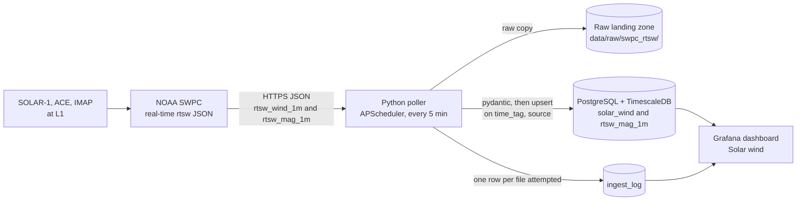

# About this page: Solar wind

> **Last reviewed:** 2026-10-26 · **Owner:** Howard Isaacson
>
> Written from [the About template](../about-this-page-template.md) ([ADR 0009](../decisions/0009-about-this-page-for-every-section.md)).

The only surface for this section is the Grafana dashboard **Solar wind** (uid `solar-wind`). There is no website page yet ([ADR 0007](../decisions/0007-grafana-now-react-later-for-frontend.md)). After `docker compose up`, open `http://127.0.0.1:3000` (host port `GRAFANA_PORT` in `.env`), sign in with the Grafana admin user from `.env`, and open **Solar wind**. The dashboard's **About this page** link and the narrow-window note point back at this file: [`docs/about/solar-wind.md`](https://github.com/howardisaacson/tachocline-industries/blob/main/docs/about/solar-wind.md).

## 1. Purpose
Shows the real-time solar wind at L1: how fast the plasma is moving, how dense it is, and whether the magnetic field points south. That southward field is the early warning for geomagnetic storms at Earth, about 15–60 minutes later. The page is for someone looking at the dashboard and for an interviewer asking where the numbers come from. These traces are measurements published by NOAA SWPC. They are not a forecast and not a model run.

## 2. What you're seeing
The default window is the last 24 hours, in UTC. Each measurement panel uses rows where `active` is true (the spacecraft SWPC marks for forecasting) and buckets them with `time_bucket('1 minute', …)`. A null minute is a gap. If two spacecraft are active in the same minute, the point is their average. Proton temperature is stored and is not a panel.

- **Proton speed:** proton speed from `solar_wind` · units: km/s · a typical slow wind is a few hundred km/s · interesting when a fast stream is roughly 500 km/s or more.
- **Proton density:** proton density from `solar_wind` · units: protons/cm³ · dense slow wind is often several protons/cm³; fast wind is thinner.
- **Bz (GSM):** north–south magnetic field from `rtsw_mag_1m.bz_gsm` · units: nT · the axis is centered on zero; the line is red below zero and green at or above zero · interesting when Bz is negative (southward), which lets solar-wind energy into Earth's magnetosphere. This is the measured component, not a storm index.
- **Minutes since last good ingest:** age of the older of the two feeds (`rtsw_wind_1m` and `rtsw_mag_1m`) in `ingest_log`, not a solar-wind measurement. A good run has `error` null. Green is under 15 minutes, yellow from 15, red from 30. If a feed has never had a good run, the panel says `no good ingest`.
- **Narrow window:** a note, not data. It records the phone-width limit below.

## 3. Data source & cadence
| Item | Value |
|---|---|
| Provider | [NOAA Space Weather Prediction Center (SWPC)](https://www.swpc.noaa.gov/products/solar-wind), real-time solar wind |
| Satellite(s) / instrument(s) | SOLAR-1 (file id `SOLAR1`; primary), ACE (backup), IMAP (also in the file). The chart follows the `active` flag. We do not pick the spacecraft in code. |
| Endpoint | [`rtsw_wind_1m.json`](https://services.swpc.noaa.gov/json/rtsw/rtsw_wind_1m.json) and [`rtsw_mag_1m.json`](https://services.swpc.noaa.gov/json/rtsw/rtsw_mag_1m.json). `rtsw_ephemerides_1h.json` is not polled. |
| Format / access | JSON over HTTPS, no auth. `User-Agent` is `INGEST_USER_AGENT`. |
| Upstream update cadence | 1-minute records, rolling about 24 hours ([ADR 0003](../decisions/0003-first-data-source-noaa-swpc-real-time-solar-wind.md)) |
| Our polling cadence | `SWPC_POLL_MINUTES` (5 in `.env.example`), on startup and then on that interval |
| End-to-end latency | Not measured here. While the stack is up, a minute already in the SWPC file waits for the next poll, then up to the 1-minute Grafana refresh. L1-to-Earth travel is about 15–60 minutes; that is physical warning time, separate from ingest delay. |
| Processing level | Real-time and provisional. The `solar_wind` table comment calls these real-time rows, not a final science archive. |
| History we keep | Whatever the poller has upserted into the Docker volume `pgdata`. The upstream files do not carry older days. Raw copies stay under `data/raw/swpc_rtsw/<YYYY-MM-DD>/` until someone deletes them. There is no retention job in the repo. |

## 4. Data flow

SWPC publishes the two JSON files. The poller saves each body unchanged, validates every row, and upserts plasma into `solar_wind` and the magnetic field into `rtsw_mag_1m`. The same run writes `ingest_log`. Grafana reads those tables with a SELECT-only role. This repo has no continuous aggregate, no FastAPI route, and no React page on this path.

## 5. Tech used and why
| Layer | Technology | Why (one line) | Decision |
|---|---|---|---|
| Ingestion | Python, httpx, pydantic, APScheduler 3.x | One scheduled process fetches, lands raw JSON, validates, and upserts. | [ADR 0004](../decisions/0004-python-scheduled-pollers-with-raw-landing-zone.md) |
| Storage | PostgreSQL + TimescaleDB | Hypertables `solar_wind` and `rtsw_mag_1m`, primary key `(time_tag, source)`, 7-day chunks. | [ADR 0005](../decisions/0005-postgresql-timescaledb-for-time-series-storage.md) |
| Visualisation | Grafana 13.2.4 | Internal mission control. The public React site is later and is not built. | [ADR 0007](../decisions/0007-grafana-now-react-later-for-frontend.md) |
| Runtime | Docker Compose | `db`, `migrate`, `ingest`, and `grafana` on the laptop. Database files live in the `pgdata` volume. | [ADR 0002](../decisions/0002-build-locally-first-with-docker-compose.md), [ADR 0008](../decisions/0008-modular-monolith-before-microservices.md) |
| This feed | NOAA SWPC `json/rtsw` | First source: no account, 1-minute plasma and magnetic field, several spacecraft in one file. | [ADR 0003](../decisions/0003-first-data-source-noaa-swpc-real-time-solar-wind.md) |

Key code: [`ingest/ti_ingest/swpc.py`](../../ingest/ti_ingest/swpc.py), [`ingest/ti_ingest/models.py`](../../ingest/ti_ingest/models.py), [`ingest/ti_ingest/load.py`](../../ingest/ti_ingest/load.py), [`ingest/ti_ingest/__main__.py`](../../ingest/ti_ingest/__main__.py), [`db/migrations/0001_solar_wind.sql`](../../db/migrations/0001_solar_wind.sql), [`dashboards/json/solar-wind.json`](../../dashboards/json/solar-wind.json).

## 6. Known limitations
- No new rows while the local stack is off ([ADR 0002](../decisions/0002-build-locally-first-with-docker-compose.md)). A missed interval does not replay a backlog; the next run fetches the current files, which only hold about a day.
- The data are real-time and provisional. As of the 2026-10-25 note in `models.py`, the live JSON also carries alpha-particle values, proton velocity, angles, and quality flags. `extra="ignore"` leaves those in the raw file. The dashboard does not show a quality flag, and a chart point is still not a final archive product.
- The old `products/solar-wind/plasma-7-day.json` endpoints are gone ([ADR 0003](../decisions/0003-first-data-source-noaa-swpc-real-time-solar-wind.md)). A missing required key is a rejected row (`rows_rejected`). An HTTP 4xx is logged and not retried; HTTP 429 stops the rest of that run. The next try is the next scheduled poll.
- A validation reject still leaves `ingest_log.error` null, so the health panel can stay green while some rows were dropped. `error` is set when the file was not loaded.
- If Postgres is down, the raw files stay on disk and that run is not upserted.
- Narrow window: each panel is one full-width row, so speed, density, Bz, and the health stat stack. Grafana's own menu and time picker stay. Below 640 px the page is tall, and that menu can crowd a 320 px window. No browser check was done in the dashboard pull request. The limit is written on the dashboard and in [the roadmap](../ROADMAP.md).
- [ADR 0005](../decisions/0005-postgresql-timescaledb-for-time-series-storage.md) describes continuous aggregates. They are not in `0001_solar_wind.sql`, so this dashboard queries the 1-minute hypertables.
- Next: check the dashboard in a real narrow browser window; decide whether a later migration should store quality flags; add a raw-file retention rule when disk growth matters.

## 7. Interview talking points
- **30-second pitch:** NOAA SWPC publishes about a day of 1-minute solar wind from L1. A Python poller saves the raw JSON, checks each row with pydantic, and upserts Postgres on `(time_tag, source)` so a rerun does not duplicate a minute. Grafana charts active-spacecraft speed, density, and Bz, plus how long since the last good ingest. The numbers are real-time measurements, provisional, and not a model.
- **Hardest problem:** One file mixes spacecraft, and the same minute can arrive again on the next poll. The natural key `(time_tag, source)` plus `ON CONFLICT DO UPDATE` makes that idempotent. `ingest_log.source` is the file name, not the spacecraft id.
- **Trade-off I made:** Polling every 5 minutes is slower than the 1-minute files and polite to SWPC. A 4xx is not retried inside the run. APScheduler is enough for one feed; an orchestrator waits until there are more feeds ([ADR 0004](../decisions/0004-python-scheduled-pollers-with-raw-landing-zone.md)).
- **How I know it works:** `tests/test_swpc_poller.py` and `tests/test_swpc_load.py` mock HTTP and the database. They check the raw bytes, rejects, the upsert SQL, a rerun that does not add rows, a 429 that skips the other file, and a database outage that still keeps the raw file. `ingest_log` and the health panel are the runtime signal. CI runs ruff and pytest. I have not watched a live Grafana window at 320 px.
- **If I had more time / at scale:** Backfill from NOAA NCEI, retention for raw files, hourly continuous aggregates, then the FastAPI read API and the React page. Cloud comes only after the criteria in [ADR 0011](../decisions/0011-cloud-deployment-target-deferred-with-criteria.md).
- **Likely questions & my answers:**
  - Q: "What happens if the SWPC feed is down for an hour?" A: "That run logs the failure and does not hammer a 4xx. The next poll is the scheduled one. Rows already upserted stay. Because the file is only about 24 hours, an hour-long outage is still inside the window once SWPC is back. A day with the laptop off is a gap we cannot fill from these files."
  - Q: "Why not InfluxDB?" A: "The rest of the site will also store orbits and events, and SQL is the skill I want to be able to explain. TimescaleDB adds hypertables on Postgres ([ADR 0005](../decisions/0005-postgresql-timescaledb-for-time-series-storage.md)). Grafana already speaks Postgres."
  - Q: "Is Bz a prediction of a storm?" A: "No. It is the measured GSM Z component from the SWPC magnetic-field file. Southward Bz is a physical driver people watch. This dashboard does not run a geomagnetic model and does not plot Kp."

## 8. Glossary
| Term | Plain-language meaning |
|---|---|
| L1 (Lagrange point 1) | A spot about 1.5 million km toward the Sun where a spacecraft can sit between the Sun and Earth and sample the wind before it reaches us. |
| Bz (GSM) | The north–south part of the interplanetary magnetic field in geocentric solar magnetospheric coordinates. Negative means southward. Unit: nanotesla (nT). |
| `active` | The boolean SWPC sets on the spacecraft its forecasters are using. The charts filter on it. |
| Real-time, provisional | The operational feed, good enough to watch now, not a later reprocessed science archive. |
| Upsert | Insert a row, or update it if `(time_tag, source)` is already there, so a second poll does not create a second copy of that minute. |
| Hypertable | A Postgres table that TimescaleDB splits into time chunks. Here the chunk interval is 7 days, and the time column has to be part of the primary key. |
| Raw landing zone | The folder where each HTTP body is saved unchanged, before validation. Replay starts from those files. |
| `time_bucket` | A Timescale function that rounds timestamps into equal bins. These panels use one-minute bins. |
