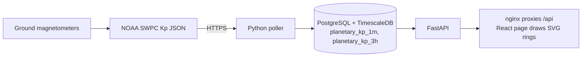

# About this page: Space weather

> **Last reviewed:** 2026-10-27 · **Owner:** Howard Isaacson
>
> Written from [the About template](../about-this-page-template.md) ([ADR 0009](../decisions/0009-about-this-page-for-every-section.md)).

The page is the public site at `http://127.0.0.1:8080` (host port `WEB_PORT`). The in-page **About** link points at this file: [`docs/about/space-weather.md`](https://github.com/howardisaacson/tachocline-industries/blob/main/docs/about/space-weather.md). Grafana still has the time-on-x charts. This page does not replace them.

## 1. Purpose
Shows how disturbed Earth's magnetic field is, at three zoom levels, without copying the usual "time on the x-axis" chart. The page is for a visitor who wants the current Kp and for an interviewer asking why the picture is a clock. The numbers are real-time SWPC estimates. They are not the definitive GFZ Kp and they are not a forecast.

## 2. What you're seeing
The hero is the latest 1-minute `estimated_kp`. Below G1 means Kp is under 5. G1 and above follow [NOAA's scale](https://www.swpc.noaa.gov/noaa-scales-explanation).

Each ring is one lap. Twelve o'clock is the start of that lap. Time runs clockwise. Distance from the center is Kp. The largest value in the window sits on the outer ring unless **Fixed 0–9 scale** is on. A white dot on the rim is now. Older samples are fainter. Gold through red is Kp 5 and above, so a quiet day that fills its own ring does not look like a storm. An empty arc is a time Tachocline has not stored. It is not a zero.

- **One day:** 1-minute estimated Kp averaged into 10-minute bins. The lap starts at midnight UTC. About 144 bins when the day is full.
- **30 days:** GFZ 3-hour Kp. The lap starts on the 1st of the month, UTC. The values are the latest 30 days.
- **One year:** the daily maximum of GFZ 3-hour Kp. The lap starts on 1 January UTC.
- **11 years:** the daily maximum of GFZ Kp. The lap is 11 × 365 days measured from 1 January 1932. A recent row can still be a nowcast. The next daily file replaces it.

The table under each ring lists the same bins, newest first. **Download CSV** saves `time_utc`, `kp`, and `g_scale`. Hover or drag on the ring to read one bin. The header chip repeats the latest Kp.

## 3. Data source & cadence
| Item | Value |
|---|---|
| Provider | [NOAA SWPC](https://www.swpc.noaa.gov/products/planetary-k-index), real-time estimated Kp. The page reads it from our API, not from SWPC directly. |
| Satellite(s) / instrument(s) | Ground magnetometers. The 3-hour product names Sitka, Meanook, Ottawa, Fredericksburg, Hartland, Wingst, Niemegk, and Canberra. |
| Endpoint | `GET /api/kp-1m` for the day ring and the hero. `GET /api/kp-gfz` for the 30-day, year, and 11-year rings. |
| Format / access | JSON over HTTP, no auth, same origin. The `web` container proxies `/api` to the API container. |
| Upstream update cadence | 1-minute estimated Kp and 3-hour estimated Kp ([data_sources.md](../research/data_sources.md)). |
| Our polling cadence | `SWPC_POLL_MINUTES` (5 in `.env.example`). |
| End-to-end latency | Not measured. A row is visible after the next poll and a reload of the page. The page does not refresh itself. |
| Processing level | Real-time. The API body says `processing_level: real-time`. |
| History we keep | The day call asks for 24 hours of SWPC 1-minute Kp (limit 2000). The longer rings ask for 11 × 365 days of GFZ Kp (limit 40000). GFZ publishes the series since 1932. |

## 4. Data flow

The poller stores the rows. The page asks the API for them. FastAPI checks the window, then runs a SELECT as the read-only role. The browser draws the rings. It never opens Postgres.

## 5. Tech used and why
| Layer | Technology | Why (one line) | Decision |
|---|---|---|---|
| Page | React, built with Vite | Components for the hero, the three rings, and the tables. | [ADR 0007](../decisions/0007-grafana-now-react-later-for-frontend.md), [ADR 0021](../decisions/0021-react-vite-page-with-svg-radial-plots.md) |
| Picture | SVG | Each segment can fade and take a G-scale color. | [ADR 0020](../decisions/0020-radial-time-plots-for-space-weather.md) |
| API | FastAPI | The page reads Kp through GET routes. | [ADR 0006](../decisions/0006-fastapi-for-backend-api.md) |
| Runtime | nginx in the `web` container | Static files, and `/api` stays on the page's origin. | [ADR 0014](../decisions/0014-when-to-use-more-than-one-docker-container.md) |

Key code: [`web/src/App.jsx`](../../web/src/App.jsx), [`web/src/kp.js`](../../web/src/kp.js), [`web/src/RadialPlot.jsx`](../../web/src/RadialPlot.jsx), [`api/ti_api/main.py`](../../api/ti_api/main.py).

## 6. Known limitations
- The day ring is an SWPC estimate. The longer rings are GFZ Kp. They are not the same product. A GFZ nowcast is labeled `definitive: false` on the API row. The ring draws the number either way.
- The page does not poll. Reload it to see a newer minute.
- Radius auto-scale makes a quiet day look as large as a storm. The G-scale colors and the fixed 0–9 switch are there for that. The table has the exact numbers.
- Alerts, solar wind, GOES, and satellite altitude stay on the API and on Grafana. This page is Kp only.
- The sun in the hero is a CSS gradient. The TI graphic is not in `assets/brand/` yet.
- The layout is dark on purpose, from the design brief. `prefers-reduced-motion` turns off the live-dot blink and the button transition.
- No live call against the running stack was made for this page. Tests mock the API.

## 7. Interview talking points
- **30-second pitch:** The live number is SWPC's 1-minute estimated Kp. The longer clocks are GFZ's Kp since 1932, kept in a separate table so the estimate and the definitive index are not mixed. Angle is time, radius is Kp, and the stroke fades until the next lap overwrites it.
- **Hardest problem:** The SWPC files are short, and they are a different product from GFZ. The long rings call `GET /api/kp-gfz`, which allows 4200 days. The 1-minute route stays at 7 days.
- **Trade-off I made:** SVG instead of Plotly for this picture, because one Plotly line cannot fade segment by segment. Plotly is still the plan for a normal line chart.
- **How I know it works:** `web/src/kp.test.js` checks the bin average, the lap overwrite, the daily maximum, and the request windows. Playwright loads the page at 320, 375, 390, 1280, and 1440 px with a mocked API, and checks a failed API as well. Run both from `web/` with `npm test` and `npx playwright test`. The GitHub Actions workflow does not run them yet.
- **If I had more time / at scale:** Refresh the page on a timer. Add the other tiles from the design brief.
- **Likely questions & my answers:**
  - Q: "Why is twelve o'clock not 'now'?" A: "Now is the moving head. Twelve o'clock is a fixed UTC boundary, so the same hour sits in the same place every lap."
  - Q: "Why can a quiet day fill the circle?" A: "The radius auto-scales to the largest value in that window. The label and the 0–9 switch tell you which scale you are looking at."

## 8. Glossary
| Term | Plain-language meaning |
|---|---|
| Kp | A 0 to 9 index of how disturbed Earth's magnetic field is, averaged from ground magnetometers. |
| G-scale | NOAA's geomagnetic storm scale. G1 starts at Kp 5. G5 is Kp 9. |
| Lap | One trip around the ring: 24 hours, 30 days, or 365 days. |
| Estimated Kp | SWPC's real-time number. The definitive index from GFZ comes later. |
