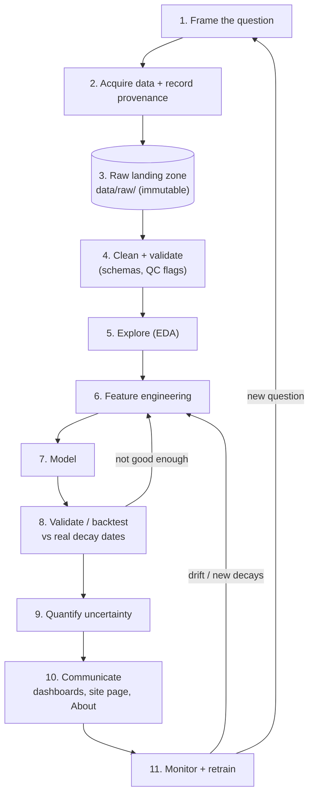

# The data science workflow on Tachocline Industries

> **Status:** plan (no model code yet). This will become a **public site page** ("How the science is done") with its own About page (`docs/about/data-science-workflow.md`, [ADR 0009](decisions/0009-about-this-page-for-every-section.md)). Decision: [ADR 0016](decisions/0016-data-science-workflow-as-first-class-feature.md).

Howard wants to **highlight** this skill: taking a vague question all the way to a validated, monitored, clearly communicated answer. The worked example throughout is **Drag Watch**, which models how solar activity (Kp/Ap, F10.7) speeds up the orbital decay of low-Earth-orbit satellites and predicts re-entry dates. The data and physics background is in [research/satellite_orbit_decay_data.md](research/satellite_orbit_decay_data.md).

## The workflow at a glance

The loops matter: validation sends you back to features, and monitoring sends you back to retraining or to a new question. Real data science is iterative, not a straight line.

## Step by step

| # | Step | Drag Watch example | Repo location | Tools | ADR |
|---|---|---|---|---|---|
| 1 | **Question framing** | "Given a LEO satellite's recent orbit and forecast solar activity, when will it re-enter, and how much do storms bring that date forward?" Define the target (re-entry date / dh/dt), the users, and success metric (e.g., median absolute error in days at 30/7/1 days before decay). | `docs/research/`, `docs/ideas.md` | Markdown | [0016](decisions/0016-data-science-workflow-as-first-class-feature.md) |
| 2 | **Acquisition & provenance** | GP/TLE history (Space-Track `gp_history`, CelesTrak), decay dates (SATCAT), indices (GFZ Kp/ap/F10.7 file, CelesTrak SW-All.csv). Record source URL, retrieval time, licence, and request parameters for every file. | `ingest/` | Python, httpx | [0003](decisions/0003-first-data-source-noaa-swpc-real-time-solar-wind.md), [0004](decisions/0004-python-scheduled-pollers-with-raw-landing-zone.md) |
| 3 | **Raw landing zone** | Store every download byte-for-byte with a hash and a manifest entry; never edit. Re-runs read from here, not the internet. | `data/raw/<source>/<date>/` (git-ignored) | filesystem → object storage later | [0004](decisions/0004-python-scheduled-pollers-with-raw-landing-zone.md) |
| 4 | **Cleaning & validation** | Parse TLEs, drop duplicates by (NORAD ID, epoch), flag ISS reboosts (altitude jumps), handle missing indices, convert units, mark provisional vs definitive indices. Schema checks fail loudly. | `ingest/`, `db/migrations/` | pydantic, pandera, SQL constraints | [0004](decisions/0004-python-scheduled-pollers-with-raw-landing-zone.md), [0005](decisions/0005-postgresql-timescaledb-for-time-series-storage.md) |
| 5 | **EDA** | Plot altitude vs time with storm periods shaded; dh/dt vs Ap and F10.7 by altitude band; the Feb 2022 Starlink group; check for outliers and gaps. | `notebooks/` (exploration only) | Jupyter, pandas/Polars, Plotly | [0016](decisions/0016-data-science-workflow-as-first-class-feature.md) |
| 6 | **Feature engineering** | Perigee/apogee altitude from mean motion and eccentricity; BSTAR; lagged and rolling Ap/Kp (storms act with hours of delay); F10.7 and its 81-day mean; MSIS density at altitude (`pymsis`). | `analysis/features/` | NumPy, sgp4/Skyfield, pymsis | [0015](decisions/0015-where-rust-could-fit.md) (if it becomes a hot path) |
| 7 | **Modelling** | Baselines first: (a) "persistence" (current dh/dt continues); (b) physics-lite dh/dt ≈ −k·ρ(h, F10.7, Ap) with k fitted per satellite, integrated forward under quiet/current/storm scenarios; (c) then regression or gradient boosting on features. Always compare against the baselines. | `analysis/models/` | statsmodels, scikit-learn | [0016](decisions/0016-data-science-workflow-as-first-class-feature.md) |
| 8 | **Validation / backtesting** | **Time-aware** splits only (train on the past, predict the future; never random shuffles). Hold out whole satellites. Backtest: for each decayed object, predict from its data at T−30/7/1 days and compare with the SATCAT decay date. Report the error per altitude band and solar-activity level. | `analysis/backtest/`, `tests/` | scikit-learn `TimeSeriesSplit`, pytest | [0016](decisions/0016-data-science-workflow-as-first-class-feature.md) |
| 9 | **Uncertainty** | Prediction intervals from backtest residuals (empirical quantiles); scenario bands (quiet vs storm); bootstrap k. Show a **range of dates**, never a single date with false precision. | `analysis/models/` | NumPy, statsmodels | [0016](decisions/0016-data-science-workflow-as-first-class-feature.md) |
| 10 | **Communication** | Grafana panel for internal checks; public Drag Watch page with altitude curves, a re-entry outlook table with intervals, a "how wrong were we?" backtest chart, and an About page with limitations. Plain-language summary first, details after. | `dashboards/`, `web/`, `docs/about/` | Grafana, React + Plotly | [0007](decisions/0007-grafana-now-react-later-for-frontend.md), [0009](decisions/0009-about-this-page-for-every-section.md), [0012](decisions/0012-responsive-design-mobile-and-desktop.md) |
| 11 | **Monitoring & retraining** | Each new real decay is a free test case: log predicted vs actual automatically, alert when error drifts (e.g., in solar max vs min), retrain on a schedule or when drift is detected. Track data freshness in `ingest_log`. | `analysis/`, `ingest/` | scheduler, SQL, Grafana alerts | [0004](decisions/0004-python-scheduled-pollers-with-raw-landing-zone.md) |

New folders this introduces: `notebooks/` (exploration) and `analysis/` (importable, tested Python package code). They will be created when Phase 5 starts.

## Interview talking points, one per step
1. **Framing:** "I wrote down the decision the model supports and the error metric *before* touching data, so success was defined up front."
2. **Provenance:** "Every file has its source, retrieval time and parameters recorded, so any chart traces back to the exact bytes it came from."
3. **Raw zone:** "Raw data is immutable; parsing bugs are fixed by re-running from raw, not by re-downloading or hand-editing."
4. **Cleaning:** "The tricky part was physical, not syntactic: ISS reboosts look like negative decay, so I detected and segmented them."
5. **EDA:** "EDA showed the storm effect lags Kp by hours and is strongest below ~400 km, which directly shaped my features."
6. **Features:** "I derived altitude from orbital elements and added lagged geomagnetic indices and model air density, encoding the physics as features."
7. **Modelling:** "I started with a persistence baseline and a physics-lite drag model; any ML model had to beat both to earn its complexity."
8. **Backtesting:** "I validated on time-ordered splits and held-out satellites against real re-entry dates, avoiding leakage from the future."
9. **Uncertainty:** "Predictions are ranges derived from backtest errors, plus quiet and storm scenarios, because solar activity itself is uncertain."
10. **Communication:** "Every result page leads with a plain-language answer and links to an About page explaining data, method and limitations."
11. **Monitoring:** "Each new re-entry automatically scores the model, so I can see drift, for example across the solar cycle, and retrain."

## Reproducibility practices
- **Notebooks vs scripts:** notebooks are for *exploration and storytelling*. Anything reused (loading, features, models, backtests) moves into the `analysis/` package with tests. Notebooks import from it. Use **Jupytext** to pair notebooks with `.py` files so diffs are reviewable, and strip outputs before committing. Use **papermill** if a notebook must run as a parameterised report.
- **Environments:** pin dependencies with a lockfile. Recommended: **uv** (`pyproject.toml` + `uv.lock`). The same image is used in Docker. Record Python and package versions with each run.
- **Data versioning:** raw files are immutable and identified by hash, with a manifest (source, URL, retrieved_at, sha256). Derived datasets are rebuilt by code from raw. If datasets get large or shared, consider **DVC** (git-like versioning for data, with remote storage). Database snapshots are tagged by migration version.
- **Determinism:** set random seeds; avoid "latest" in queries used for training; write the time cut-off of every training set into its metadata.
- **Experiment tracking:** start with a simple `experiments/` CSV or JSON log (params, data hash, git commit, metrics). Adopt **MLflow** tracking (self-hosted container, free) once there are more than a handful of model variants; it also gives a model registry. Alternatives: DVC experiments, Weights & Biases (hosted). The choice gets an ADR at that point.
- **Tests:** unit tests for feature functions (e.g., altitude from mean motion against known values), schema tests on data, and a small "golden" backtest that CI runs on a fixed sample.
- **One command:** `make backtest` (or `uv run python -m analysis.backtest`) reproduces the published numbers from raw data.

## Learn more
- The Turing Way, [Guide for reproducible research](https://book.the-turing-way.org/reproducible-research/reproducible-research/)
- scikit-learn, [Cross-validation](https://scikit-learn.org/stable/modules/cross_validation.html) and [`TimeSeriesSplit`](https://scikit-learn.org/stable/modules/generated/sklearn.model_selection.TimeSeriesSplit.html)
- [MLflow docs](https://mlflow.org/docs/latest/), [DVC docs](https://dvc.org/doc), [uv docs](https://docs.astral.sh/uv/), [Jupytext](https://jupytext.readthedocs.io/), [pandera](https://pandera.readthedocs.io/)
