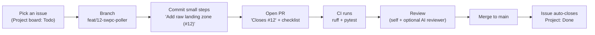

# How we use GitHub on Tachocline Industries

A plain-language guide to the planning and change workflow ([ADR 0018](decisions/0018-plan-work-with-github-issues-milestones-projects.md)). It's written so Howard can both *use* it and *explain* it.

## The building blocks
| Thing | What it is | How TI uses it |
|---|---|---|
| **Issue** | A unit of work with a discussion thread | One task, bug, research question, or ADR review |
| **Label** | A tag | `type: …` (what kind of work), `area: …` (which part of the system), `good first issue`, `learning` |
| **Milestone** | A goal grouping issues, with a progress bar | One per roadmap phase (Phase 0 … Phase 5) |
| **Sub-issue** | A child of a parent issue | Breaks epics (e.g., "Phase 1: solar wind end to end", "Drag Watch") into PR-sized steps |
| **Project** | A board/table/roadmap over issues, with custom fields | "Tachocline Industries Roadmap": Status, Phase, Priority (P0–P2), Size (XS–L) |
| **Pull request (PR)** | A proposed change, reviewed before merging into `main` | Every change; says `Closes #N` |
| **Actions (CI)** | Automated checks on each push/PR | ruff + pytest; required to merge |

## The everyday loop

1. **Pick** an issue from the board (Todo) and move it to *In Progress*. Small and well-defined first; `good first issue` is the warm-up label.
2. **Branch** off `main`, named `type/<issue#>-short-name` (e.g., `feat/12-swpc-poller`, `docs/31-solar-wind-about`, `adr/5-review-timescale`).
3. **Commit** in small, meaningful steps. Mentioning `#12` in a commit message links it to the issue.
4. **Open a PR** using the template: what and why, `Closes #12`, how it was tested, and the ADR / About-page / mobile-desktop / secrets checkboxes.
5. **CI** must pass. Review your own diff (and optionally an AI reviewer). Fix anything flagged.
6. **Merge** (squash merge keeps `main` history tidy). `Closes #12` closes the issue, and the Project moves it to *Done*.

## Planning rhythm (solo version of what teams do)
- **Weekly (15 min):** look at the current milestone. Set Priority and Size on new issues and pick the week's 2–4 issues. This is a mini "sprint planning".
- **When scope changes:** edit the issue or create new ones. Update ROADMAP.md in the same PR if the phase plan changes.
- **When a phase ends:** close the milestone and write a short retro note in the milestone description (what went well, what to change).

## ADRs and issues
Every Proposed ADR has a **"Review ADR NNNN: …"** issue (`type: adr`), as sub-issues of "Review all Proposed ADRs". To accept one: open a PR that changes its status to Accepted and updates the index, with `Closes #N`. New decisions start as an issue from the **ADR proposal / review** template.

## Labels cheat sheet
- **type:** `feature`, `docs`, `research`, `adr`, `chore`, `bug`
- **area:** `ingest`, `db`, `api`, `dashboards`, `web`, `ds`, `agents`, `infra`, `rust`, `brand`
- **meta:** `good first issue` (small starter), `learning` (main point is a new skill; note it for interviews)

## How this maps to other tools (interview angle)
| GitHub | Jira | Linear |
|---|---|---|
| Issue | Story / Task / Bug | Issue |
| Parent issue + sub-issues | Epic + child issues / sub-tasks | Project / parent + sub-issues |
| Milestone | Release / Fix version (or Epic) | Cycle or Project milestone |
| Project (Board view) | Board | Board |
| Labels | Labels / Components | Labels |
| `Closes #12` | Smart commits / dev panel links | Magic words / branch linking |

**Sample interview answer:** "I ran the project like a small team would: a roadmap broken into milestones, issues with acceptance criteria and sub-issues for epics, a Project board with Priority and Size, and every PR closing an issue with CI required. I scripted the initial setup with the GitHub CLI so it was repeatable, which also taught me the REST and GraphQL APIs."

## What is set up in the repo

### Continuous integration

A **GitHub Actions workflow** is a YAML file in `.github/workflows/` that GitHub runs when an event happens, such as opening a pull request. Ours is [`.github/workflows/ci.yml`](../.github/workflows/ci.yml). The workflow's name is `CI`. It runs on every pull request and on every push to `main`, on Python 3.12.

A **status check** is the pass/fail result of one job. Branch protection can require a check by its exact name before a merge. These two jobs are the checks:

| Job name | What it runs | Why two jobs |
|---|---|---|
| `lint` | `ruff check .` and `ruff format --check .` | A formatting failure stays visible even if tests fail, and the other way around. |
| `test` | `pytest` | Unit tests read files in the repo. They do not call the network. |

Tool versions are pinned in `requirements-dev.txt` (ruff 0.17.2, pytest 9.1.1). `tools/gh-setup/` is excluded from ruff in `pyproject.toml` so turning CI on did not reformat the plan generator. New Python under `tests/`, and later `ingest/` and `api/`, is checked.

The status-check names are whatever GitHub reports for the jobs, not the workflow filename. On the first run ([run 40066513270](https://github.com/howardisaacson/tachocline-industries/actions/runs/40066513270), pull request #60) `gh pr checks` and the check-runs API both reported exactly `lint` and `test`, from the GitHub Actions app (app id `15368`). Branch protection has to use those strings. A name like `CI / lint` would wait for a check that this workflow does not publish. Re-check with `gh pr checks` if a job is renamed.

Learn more: [Building and testing Python](https://docs.github.com/en/actions/automating-builds-and-tests/building-and-testing-python), [About status checks](https://docs.github.com/en/pull-requests/collaborating-with-pull-requests/collaborating-on-repositories-with-code-quality-features/about-status-checks).

### Branch protection and secret scanning

A **branch protection rule** is a setting on a branch (here, `main`) that GitHub enforces: for example, changes must arrive through a pull request, required status checks must pass, and force-pushes are blocked. It is not a file in the repo. [About protected branches](https://docs.github.com/en/repositories/configuring-branches-and-merges-in-your-repository/managing-protected-branches/about-protected-branches).

**Secret scanning** reads git history for known credentials (API keys, tokens). **Push protection** blocks a push that contains one. [About secret scanning](https://docs.github.com/en/code-security/secret-scanning/introduction/about-secret-scanning).

The repository is **public**.

**On:**

- The CI workflow above. Jobs `lint` and `test` are the status checks.
- **Secret scanning** and **push protection**. Howard ran the admin `PATCH` on the public repo and it succeeded. `.gitignore` still keeps `.env` out of git, and `!.env.example` keeps the template.

**Still off:** branch protection on `main`. Howard ran the admin `PUT`. GitHub returned HTTP 422:

> No subschema in "anyOf" matched. More than one subschema in "oneOf" matched. Not all subschemas of "allOf" matched. For 'anyOf/1', the required_status_checks object that contains both "contexts" and "checks" is not a null.

`required_status_checks` takes one of two shapes. `contexts` is the older list of check names. `checks` is the newer list, and each entry also names the GitHub App that must report that check. The schema allows one of those fields. Sending both fails validation before any rule is saved. [Update branch protection](https://docs.github.com/en/rest/branches/branch-protection#update-branch-protection).

The command below drops `contexts` and keeps `strict` plus `checks` for `lint` and `test` from GitHub Actions (app id `15368`). The rest of the rule is unchanged: a pull request is required, zero approving reviews (ADR 0010: the solo maintainer may self-merge), the branch must be up to date, admins cannot bypass, force-pushes are blocked, and the branch cannot be deleted. This pull request does not call the API. The automation token is not an admin. An owner runs:

```bash
gh api --method PUT \
  -H "Accept: application/vnd.github+json" \
  repos/howardisaacson/tachocline-industries/branches/main/protection \
  --input - <<'EOF'
{
  "required_status_checks": {
    "strict": true,
    "checks": [
      {"context": "lint", "app_id": 15368},
      {"context": "test", "app_id": 15368}
    ]
  },
  "enforce_admins": true,
  "required_pull_request_reviews": {
    "dismiss_stale_reviews": false,
    "require_code_owner_reviews": false,
    "required_approving_review_count": 0,
    "require_last_push_approval": false
  },
  "restrictions": null,
  "required_linear_history": false,
  "allow_force_pushes": false,
  "allow_deletions": false,
  "block_creations": false,
  "required_conversation_resolution": false,
  "lock_branch": false,
  "allow_fork_syncing": false
}
EOF
```

## Setup scripts
The labels, milestones, issues, and Project were seeded from the roadmap by idempotent scripts kept outside the repo (`gh-setup/`: `issues.json`, `setup_labels_milestones_issues.sh`, `setup_project.sh`). They write only to `howardisaacson/tachocline-industries`. Project views and built-in workflows are finished in the web UI.

## Learn more
- GitHub Docs: [About Projects](https://docs.github.com/en/issues/planning-and-tracking-with-projects/learning-about-projects/about-projects), [Sub-issues](https://docs.github.com/en/issues/tracking-your-work-with-issues/using-issues/adding-sub-issues), [Milestones](https://docs.github.com/en/issues/using-labels-and-milestones-to-track-work/about-milestones), [Linking PRs to issues](https://docs.github.com/en/issues/tracking-your-work-with-issues/using-issues/linking-a-pull-request-to-an-issue), [Issue forms syntax](https://docs.github.com/en/communities/using-templates-to-encourage-useful-issues-and-pull-requests/syntax-for-issue-forms)
- [GitHub CLI `gh project` manual](https://cli.github.com/manual/gh_project)
