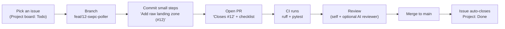

# How we use GitHub on Tachocline Industries

A plain-language guide to the planning and change workflow ([ADR 0018](decisions/0018-plan-work-with-github-issues-milestones-projects.md)). It's written so Howard can both *use* it and *explain* it.

## The building blocks
| Thing | What it is | How TI uses it |
|---|---|---|
| **Issue** | A unit of work with a discussion thread | One task, bug, research question, or ADR review |
| **Label** | A tag | `type: …` (what kind of work), `area: …` (which part of the system), `good first issue`, `learning` |
| **Milestone** | A goal grouping issues, with a progress bar | One per roadmap phase (Phase 0 … Phase 5) |
| **Sub-issue** | A child of a parent issue | Breaks epics (e.g., "Phase 1: solar wind end to end", "Drag Watch") into PR-sized steps |
| **Project** | A board/table/roadmap over issues, with custom fields | "Tachocline Industries Roadmap": Status, Phase, Priority (P0–P2), Size (XS–L) |
| **Pull request (PR)** | A proposed change, reviewed before merging into `main` | Every change; says `Closes #N` |
| **Actions (CI)** | Automated checks on each push/PR | ruff + pytest; required to merge |

## The everyday loop

1. **Pick** an issue from the board (Todo) and move it to *In Progress*. Small and well-defined first; `good first issue` is the warm-up label.
2. **Branch** off `main`, named `type/<issue#>-short-name` (e.g., `feat/12-swpc-poller`, `docs/31-solar-wind-about`, `adr/5-review-timescale`).
3. **Commit** in small, meaningful steps. Mentioning `#12` in a commit message links it to the issue.
4. **Open a PR** using the template: what and why, `Closes #12`, how it was tested, and the ADR / About-page / mobile-desktop / secrets checkboxes.
5. **CI** must pass. Review your own diff (and optionally an AI reviewer). Fix anything flagged.
6. **Merge** (squash merge keeps `main` history tidy). `Closes #12` closes the issue, and the Project moves it to *Done*.

## Planning rhythm (solo version of what teams do)
- **Weekly (15 min):** look at the current milestone. Set Priority and Size on new issues and pick the week's 2–4 issues. This is a mini "sprint planning".
- **When scope changes:** edit the issue or create new ones. Update ROADMAP.md in the same PR if the phase plan changes.
- **When a phase ends:** close the milestone and write a short retro note in the milestone description (what went well, what to change).

## ADRs and issues
Every Proposed ADR has a **"Review ADR NNNN: …"** issue (`type: adr`), as sub-issues of "Review all Proposed ADRs". To accept one: open a PR that changes its status to Accepted and updates the index, with `Closes #N`. New decisions start as an issue from the **ADR proposal / review** template.

## Labels cheat sheet
- **type:** `feature`, `docs`, `research`, `adr`, `chore`, `bug`
- **area:** `ingest`, `db`, `api`, `dashboards`, `web`, `ds`, `agents`, `infra`, `rust`, `brand`
- **meta:** `good first issue` (small starter), `learning` (main point is a new skill; note it for interviews)

## How this maps to other tools (interview angle)
| GitHub | Jira | Linear |
|---|---|---|
| Issue | Story / Task / Bug | Issue |
| Parent issue + sub-issues | Epic + child issues / sub-tasks | Project / parent + sub-issues |
| Milestone | Release / Fix version (or Epic) | Cycle or Project milestone |
| Project (Board view) | Board | Board |
| Labels | Labels / Components | Labels |
| `Closes #12` | Smart commits / dev panel links | Magic words / branch linking |

**Sample interview answer:** "I ran the project like a small team would: a roadmap broken into milestones, issues with acceptance criteria and sub-issues for epics, a Project board with Priority and Size, and every PR closing an issue with CI required. I scripted the initial setup with the GitHub CLI so it was repeatable, which also taught me the REST and GraphQL APIs."

## Setup scripts
The labels, milestones, issues, and Project were seeded from the roadmap by idempotent scripts kept outside the repo (`gh-setup/`: `issues.json`, `setup_labels_milestones_issues.sh`, `setup_project.sh`). They write only to `howardisaacson/tachocline-industries`. Project views and built-in workflows are finished in the web UI.

## Learn more
- GitHub Docs: [About Projects](https://docs.github.com/en/issues/planning-and-tracking-with-projects/learning-about-projects/about-projects), [Sub-issues](https://docs.github.com/en/issues/tracking-your-work-with-issues/using-issues/adding-sub-issues), [Milestones](https://docs.github.com/en/issues/using-labels-and-milestones-to-track-work/about-milestones), [Linking PRs to issues](https://docs.github.com/en/issues/tracking-your-work-with-issues/using-issues/linking-a-pull-request-to-an-issue), [Issue forms syntax](https://docs.github.com/en/communities/using-templates-to-encourage-useful-issues-and-pull-requests/syntax-for-issue-forms)
- [GitHub CLI `gh project` manual](https://cli.github.com/manual/gh_project)
